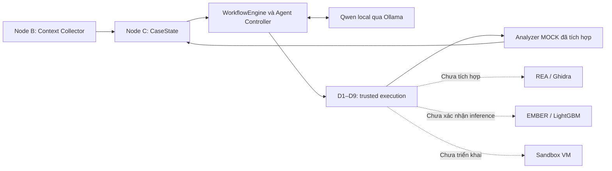

# DACN — Báo cáo tiến độ kỹ thuật gần đây


## 1. Tổng quan kiến trúc hiện tại



Node B thu quan sát từ file hoặc PID; Node C lưu evidence, nguồn gốc, unknowns và revision. WorkflowEngine giữ các cổng quyết định xác định; Agent đề xuất bước tiếp theo từ CaseState. Controller kiểm đề xuất trước khi chuyển ToolCall sang D1–D9. Kết quả hợp lệ được ghi vào Node C cho vòng điều tra kế tiếp.

Đường chạy đã kiểm chứng dùng **analyzer MOCK lành tính**. REA, ML và sandbox trong sơ đồ là điểm kết nối dự kiến, chưa phải analyzer hoạt động trong DACN. Agent không trực tiếp gọi shell hoặc thực thi binary đích; thiếu evidence có thể dẫn đến `INSUFFICIENT_EVIDENCE`. Thu thập hay chạy tool thành công chỉ phản ánh trạng thái thao tác, không chứng minh target an toàn.

## 2. Hoàn thiện Trusted Orchestrator D1–D9

PR #6 hợp nhất registry, validation, executor, execution control và case bridge; bổ sung binding D2→D5, adapter D5→D7, xử lý revision race và khôi phục ledger. Khi đó integration còn dùng admission D4/D8 giả lập. PR #7 bổ sung D1, D4, D8 thật và kiểm thử chuỗi tin cậy. Các nhãn “MISSING/MOCK” trong báo cáo integration ban đầu là trạng thái lịch sử, không mô tả toàn bộ code hiện tại.

| Module | Trách nhiệm | Trạng thái đã đối chiếu |
|---|---|---|
| D1 | Điều phối lifecycle, workflow, idempotency, commit | Đã nối D2–D9; có test chuỗi đầy đủ |
| D2 | Registry tool/version/provider và khả dụng | Đã tích hợp; không tự fallback provider |
| D3 | Kiểm schema, arguments, target binding, revision | Đã tích hợp trước admission |
| D4 | Policy xác định, mặc định từ chối, kiểm effects/budgets | Engine thật; approval không bỏ qua yêu cầu VM |
| D5 | Đọc target, revalidation, staging, chạy adapter đã pin | Đã chạy Windows với FILE; chưa có REA adapter |
| D6 | Job Object, timeout/cancel, giới hạn output, cleanup | Đã kiểm thử; không phải malware sandbox |
| D7 | Kiểm receipt/result/artifact, chuẩn hóa observation | Đã tích hợp; không tự tạo verdict malware |
| D8 | Ký kết quả, quản lý khóa, approval, analyst identity | Có signer, DPAPI/ACL; còn giới hạn cách ly |
| D9 | Ghi Node C, kiểm revision, ledger/reconcile | Đã tích hợp; chống stale commit và replay |

[Báo cáo integration](docs/integration/TEST_REPORT.md) ghi **9/9 integration test PASS**: subprocess D5/D6 chạy thật, admission D4/D8 còn MOCK. [Báo cáo D1/D4/D8](docs/d1_d4_d8/IMPLEMENTATION_STATUS.md) ghi **46 test mới PASS**, gồm sáu test chuỗi đầy đủ dùng PolicyEngine và TrustedSigner thật. Analyzer vẫn là fixture lành tính. Các kết quả thuộc những mốc khác nhau, không cộng thành số test hiện tại.

Giới hạn được ghi nhận gồm: DPAPI theo user chưa cách ly khóa khỏi analyzer cùng user; analyst identity mới xác định process-owner; idempotency tuần tự chưa ngăn mọi double-execute đồng thời. Ledger và CaseState cần reconcile, không phải một transaction filesystem duy nhất. Vì vậy, hoàn thiện tích hợp chức năng chưa đồng nghĩa bảo đảm triển khai production.

## 3. Cải tiến Node B để chuẩn bị cho REA/Ghidra

Thay đổi mới là nhận diện format bằng magic/header tại commit `0cfdc13`, `5523c55`, cùng [tài liệu REA boundary](docs/node_b/REA_BOUNDARY.md). Facet `format` được bổ sung theo hướng additive, giữ tương thích với PE header và luồng evidence hiện có.

| Format | Ý nghĩa quan sát |
|---|---|
| `PE` | Cấu trúc PE tối thiểu hợp lệ |
| `UNKNOWN` | Chưa nhận diện được magic |
| `UNSUPPORTED` | Format đã biết nhưng ngoài phạm vi analyzer cấu hình |
| `MALFORMED` | Có dấu hiệu format nhưng header lỗi hoặc bị cắt |

Code tách `detected` khỏi `analyzer_supported`, không dùng đuôi file để kết luận. `UNSUPPORTED` không có nghĩa Ghidra không đọc được format đó. Khi file thay đổi trong lúc thu thập, format và digest liên quan không được giữ như quan sát ổn định.

Binary I/O chỉ đọc, SHA-256 streaming chunk 1 MiB, file identity và TargetRef là nền tảng có từ trước, được đối chiếu lại cho ranh giới tích hợp; **không tính là toàn bộ thành tựu mới của tuần**. TargetRef mang snapshot và verified digest khi đủ điều kiện. D5/analyzer vẫn phải mở lại handle, kiểm identity, hash bytes đã stage và từ chối target thay đổi. Timeout hashing là best effort; hash backing file không chứng minh nội dung bộ nhớ process. Node B chưa chạy REA hoặc decompile; cải tiến này chuẩn bị đầu vào có provenance cho bước sau.

## 4. Unified Application

PR #9 đưa vào entry point `python -m dacn`, nối API B→C→D qua `dacn/application.py`. CLI không sao chép logic từng node. `--home` đặt trước subcommand để chọn vùng lưu trữ; các lệnh đã đối chiếu với parser:

```powershell
python -m dacn --home .\dacn_data intake --file C:\samples\benign.exe
python -m dacn --home .\dacn_data intake --pid 1234 --include-backing-file
python -m dacn --home .\dacn_data inspect --case-id CASE_ID
python -m dacn --home .\dacn_data smoke
```

`intake` gọi Node B rồi tạo hoặc cập nhật case Node C, trả collection status, định danh và đường dẫn lưu. `inspect` đọc CaseState đã persist để xem evidence, unknowns, format và revision. `smoke` trên Windows lắp D1–D9 thật, chạy benign mock analyzer, kiểm D7 và commit D9; CLI không nhận executable hoặc adapter command tùy ý.

[Báo cáo Unified Application](docs/dacn/TEST_REPORT.md) liệt kê 20 test mới cho intake/inspect/config/CLI/smoke, gồm missing file, target mismatch và DENY không chạy tool. Smoke dùng khóa TEST từ `InMemoryKeyProvider`, không phải production key store. Analyzer trả placeholder, không phải EMBER, LightGBM hay REA thật. Lệnh `investigate --case-id CASE_ID` nằm trong working tree TASK 04B, chưa thuộc commit merge PR #9.

## 5. Kiểm chứng REA/Ghidra

Theo **báo cáo của nhóm được cung cấp khi biên soạn**, REA **6.7.0**, Ghidra **12.1.4**, JDK **21** đã phân tích tĩnh PE lành tính độc lập: **327 functions, 84 strings và pseudocode thật**; có MCP session và xuất evidence bundle. Nhóm cũng báo cáo đã thử containment PoC Low-integrity. Chưa tìm thấy bundle, log session hoặc báo cáo PoC tương ứng trong repository hiện tại, nên các chi tiết này chưa được kiểm chứng trực tiếp từ artifacts tại đây.

Repository có bằng chứng độc lập khác: [benchmark RE](benchmarks/re/README.md) và [ghidra-check.json](benchmarks/re/results/ghidra-check.json) dùng **Ghidra 12.2/JDK 25.0.5**, ghi **525 functions, 49 external symbols, 80 defined strings** của `hello.exe`. Checker xác nhận marker, imports và địa chỉ `emit_message` khớp baseline; JSON ghi `target_executed=false`, không timeout. Đây là hai môi trường/lần chạy khác nhau; snapshot này không xác nhận con số 327/84 của REA.

Kết quả Ghidra trong repository là phân tích thật trên binary tự build, nhưng chỉ kiểm các điểm đối chiếu đã biết, chưa đánh giá toàn bộ functions hoặc decompiler. JSON xuất ra chưa phải D.0 ToolResult. **REA adapter vào DACN chưa hoàn tất** do ranh giới containment/policy cần giải quyết. Low-integrity PoC, REA ngoài repository và integration D1–D9 là ba mức bằng chứng riêng; chưa có cơ sở tuyên bố REA đã chạy trong workflow DACN.

## 6. Local AI Investigation Agent

Working tree TASK 04B dùng **Qwen3.5-4B Q4_K_M qua Ollama 0.40.15**, local loopback, không gọi external LLM API. Model sinh structured proposal `TOOL_CALL`, `FINISH` hoặc `REQUEST_DYNAMIC_ANALYSIS`. Controller kiểm schema theo action, evidence IDs tồn tại, residual unknown facets, case/revision, identity D2 và arguments D3. Workflow giữ static-first; mọi ToolCall tiếp tục qua D1–D9.

Context được giới hạn kích thước; dữ liệu target được đánh dấu `UNTRUSTED_CONTENT`. Agent có giới hạn iteration, tool calls, token và thời gian; duplicate/invalid proposals được xử lý hữu hạn. DENY không được đổi arguments để retry cùng tool. Sau D9 commit, loop đọc lại CaseState rồi yêu cầu model đề xuất tiếp; report giữ citations và limitations.

Theo [Recovery report](docs/task04b/RECOVERY_REPORT.md), [benchmark summary](docs/task04b/benchmark_summary.json) và live traces:

| Nhóm kiểm thử | Kết quả gần nhất | Cách hiểu |
|---|---|---|
| Agent unit | 27 PASS | Validation, budgets, timeout, duplicate, DENY |
| MockPlanner E2E | PASS | Planner giả lập; Node C/D1–D9 thật |
| Live Qwen thinking OFF | 2/2 PASS | Model thật, analyzer MOCK |
| Benchmark thinking OFF | 10/12 đạt rubric | JSON/schema/controller hợp lệ 12/12 |
| Benchmark thinking ON | 0/12 đạt | Timeout ở cap 15 giây/proposal |
| Regression D/application | 239 test, OK; 1 SKIP | Live mặc định không bật |
| Regression B/C/application | 129 test, OK; 2 SKIP | Symlink và bài file lớn có điều kiện |

Không cộng các suite thành tổng vì có thể trùng phạm vi. Số liệu regression ghi trong report; artifacts trực tiếp đối chiếu thêm được hai trace `FINISHED`, revision **3**, verdict **`INSUFFICIENT_EVIDENCE`**. [Trace lượt 1](docs/task04b/live_trace.json) và [lượt 2](docs/task04b/live_trace_v3_run2.json) cho thấy tool run thành công rồi model đánh giá evidence mới. Đây là thành công của điều phối, không phải phát hiện malware thật.

Benchmark gồm sáu scenario, mỗi scenario hai lượt cho mỗi thinking mode: known-benign, thiếu evidence, conflict, DENY, cần dynamic và prompt injection. Tổng 24 **proposal probes** dùng fixture tổng hợp trên intake benign, không phải 24 investigation E2E. OFF có latency trung bình **4,288 giây**, ON **15,033 giây** tính cả chờ timeout. Hai lỗi OFF thuộc known-benign assessment. ON thiếu usage cả 12 lượt; token báo cáo bằng 0 không có nghĩa không tiêu thụ tài nguyên. Model 1.7B không còn local khi đo nên chưa có so sánh cùng cấu hình.

**TASK 04B vẫn PARTIAL.** Token accounting ghi usage runtime và dùng reservation bảo thủ; không bảo đảm đếm chính xác mọi thinking token. Socket timeout không chứng minh GPU đã dừng; cleanup/commit có thể vượt deadline. Reputation dựa snapshot do operator duy trì, chưa có provider cập nhật độ mới. Chưa có bằng chứng miễn nhiễm mọi prompt injection hoặc độ chính xác phân loại malware.

## 7. Tổng kết tiến độ và bước tiếp theo

**Đã thực hiện trong giai đoạn báo cáo:** hợp nhất và hoàn thiện chuỗi D1–D9; bổ sung format facet và boundary Node B→REA; hợp nhất CLI; kiểm chứng Ghidra độc lập qua artifacts và ghi nhận báo cáo REA của nhóm; xây dựng Agent MVP có hai lượt live Qwen E2E thành công với analyzer MOCK.

**Chưa hoàn tất:** benchmark Agent chưa ổn định ở mọi scenario/thinking mode; REA chưa tích hợp DACN; EMBER/LightGBM inference thực chưa xác nhận; sandbox VM chưa triển khai. Các test PASS không thay thế đánh giá hiệu quả phát hiện malware hoặc bảo đảm cách ly production.

**Bước tiếp theo:** hoàn thiện độ ổn định và rubric Agent, mở rộng scenario thành full E2E lặp lại; giải quyết security boundary trước khi tích hợp REA; sau đó kết nối EMBER/LightGBM và benchmark dữ liệu phù hợp. Báo cáo giữ riêng phần đã đo, phần nhóm báo cáo và phần chưa triển khai để giảng viên theo dõi tiến độ thực tế.
