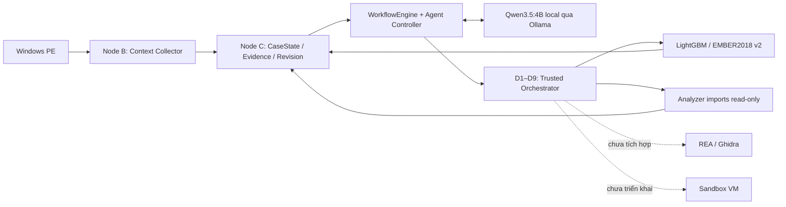

# DACN-2026 — Phát hiện và hỗ trợ điều tra mã độc Windows PE bằng AI Agent

## Tổng quan dự án

**Mục tiêu.** Xây dựng một hệ thống hỗ trợ **phát hiện, phân tích và điều tra** tệp thực thi
Windows PE, kết hợp một bộ phân loại học máy tĩnh (LightGBM) với một **AI Agent** (Qwen chạy
local) hoạt động bên trong một **lớp điều phối tin cậy D1–D9**. Câu hỏi nghiên cứu chính của
tuần: *Agent có thể chủ động thu thập và sử dụng bằng chứng mới để tạo giá trị điều tra bổ sung
so với báo cáo chỉ-dựa-trên-phân-loại-tĩnh hay không?*

Agent **không** thay thế bộ phát hiện và **không** tự thực hiện containment; nó đọc bằng chứng,
đề xuất công cụ phân tích và viết nhận định có trích dẫn, mọi hành động đều qua lớp tin cậy.



| Thành phần | Vai trò | Trạng thái |
|---|---|---|
| **Node B — Context Collector** | Thu thập identity, SHA-256, metadata PE, nhận diện format (không thực thi file) | Đã có |
| **Node C — CaseState** | Lưu evidence, provenance, unknowns, revision, lịch sử tool-run | Đã có |
| **D1–D9 — Trusted Orchestrator** | Contract, registry, policy (mặc định từ chối), target binding, thực thi adapter đã pin, validate, ký, commit evidence | Đã có |
| **LightGBM / EMBER2018 v2** | Phân loại tĩnh PE (2381 feature); điểm số đưa vào CaseState | Đã tích hợp, inference thật |
| **Analyzer imports** (`static.pe_imports_detail`) | Đọc bảng import DLL/API/ordinal, read-only, chạy qua D1–D9 | Đã có (1 analyzer) |
| **AI Agent (Qwen)** | Đọc evidence, đề xuất tool, viết assessment có trích dẫn | Đã có, chạy local thật |
| REA/Ghidra, Sandbox VM | Phân tích sâu / động | **Chưa tích hợp** vào DACN |

**Khả năng đã có:** pipeline PE → dự đoán LightGBM → Agent điều tra nhiều bước qua D1–D9 với một
analyzer imports thật, có bằng chứng được commit và Agent đọc lại ở vòng sau.
**Giới hạn hiện tại:** Agent **chưa** được chứng minh là nâng cao độ chính xác phát hiện; đánh giá
semantic/grounding mới có LLM-as-Judge (provisional), vẫn cần người chấm độc lập. Confirmatory
holdout 20 PE benign (06B-J) cho kết quả **INCONCLUSIVE, nghiêng về âm tính** về giá trị của việc
Agent tự gọi tool.

**Trạng thái phát triển:** nguyên mẫu nghiên cứu chạy được, **chưa** phải sản phẩm production.
Chi tiết kỹ thuật tuần này: [`evaluation/TASK06_FINAL_REPORT.md`](evaluation/TASK06_FINAL_REPORT.md).

---

## Tiến độ thực hiện tuần này

Tuần này tập trung vào **chuỗi phát triển AI Agent**: từ dựng Agent Qwen, tích hợp bộ phát hiện
mã độc, thực nghiệm đánh giá, đến điều tra nhiều bước và cải thiện độ tin cậy của khâu kết luận.

### 1. Xây dựng AI Agent
- Tích hợp **Qwen3.5:4B chạy local qua Ollama** (loopback, không gọi API LLM bên ngoài), thinking
  OFF mặc định, temperature 0.1, seed cố định.
- Agent nhận context/evidence từ CaseState và sinh **structured assessment** (alignment, bằng
  chứng ủng hộ/mâu thuẫn, claims, khuyến nghị, độ tin cậy), dữ liệu target được đánh dấu
  `UNTRUSTED_CONTENT`.
- Agent kết nối với **Controller** và **workflow D1–D9**: mọi ToolCall được Controller kiểm
  (schema, evidence IDs, case/revision, identity) trước khi chuyển sang lớp tin cậy.

### 2. Tích hợp mô hình phát hiện mã độc (LightGBM / EMBER2018 v2)
- Bộ phân loại **LightGBM** độc lập trên không gian feature **EMBER2018 v2 (2381 chiều)**, đánh giá
  trên tập test có nhãn (200.000 mẫu, không dùng để tuning):

  | Chỉ số (test 200k) | Giá trị |
  |---|---|
  | ROC AUC | **0.9930** |
  | Recall / TPR | 0.9171 |
  | F1 | 0.9518 |
  | False Positive Rate | **0.00998** (≈1%, khớp mục tiêu val-FPR) |
  | Threshold (khóa) | 0.83219 |

- Dự đoán được tích hợp vào pipeline xử lý PE và ghi vào **CaseState** để Agent sử dụng (model
  SHA-256 `5db192ec…c509609`, đóng băng — không train lại, không đổi threshold).
- **Lưu ý trung thực:** raw score **không phải** xác suất đã hiệu chỉnh; AUC 0.993 là mức tái lập
  nghiên cứu, không nhằm vượt SOTA; không suy rộng sang FPR thực tế ngoài tập test.

### 3. Kiểm thử và đánh giá Agent
- **Đánh giá có kiểm soát (TASK 05C, track `FEATURE_RECORD_REPLAY`):** 120 mẫu EMBER có nhãn
  (TP 25 · TN 25 · FP 25 · FN 25 · NEAR 20), so sánh **Static-only** vs **Static + Agent** trên
  *cùng* điểm số/evidence. Phát hiện quan trọng: Agent cho alignment **CONSISTENT 100%** ở mọi
  strata, kể cả **50 ca nhãn LightGBM sai (25 FP + 25 FN)** — **0 ca CONFLICT**. ⇒ Trong cấu hình
  này Agent **không** bắt lỗi detector và **không** cải thiện phát hiện; giá trị gia tăng chủ yếu
  là phần giải thích. Agent gần như luôn đòi review (98,3%).
- **Kiểm thử real benign PE (TASK 05D, track `RAW_PE_E2E`):** pipeline thật chạy trọn vẹn trên
  **35 PE hệ thống Windows ký hợp lệ** (0 lỗi, 0 false positive **trên tập này**). Nhãn benign dựa
  **provenance** (OS + chữ ký Microsoft), không chứng minh vô hại tuyệt đối.
- **Phân biệt rõ:** `FEATURE_RECORD_REPLAY` (chạy model trên feature records) **khác** `RAW_PE_E2E`
  (chạy từ tệp PE thật). Malicious raw-PE E2E = **BLOCKED** (chưa có mẫu được cấp phép).
- **Hạn chế đánh giá:** các tiêu chí semantic của rubric cần **người chấm độc lập** (không dùng LLM,
  không tự chấm); đã xuất gói chấm blind nhưng **human grading vẫn PENDING**.

### 4. Phát triển Agent điều tra nhiều bước (TASK 06B)
Bổ sung **đúng một analyzer** read-only `static.pe_imports_detail` và chứng minh **live** với Qwen thật:
Agent chủ động đề xuất tool → Controller kiểm → **D4 ALLOW** → D5/D6 thực thi adapter đã pin →
**D7** validate → **D9** commit evidence vào CaseState → revision tăng → Agent **đọc evidence mới**
ở vòng sau. Đây là **live demonstration** của workflow điều tra nhiều bước, **chưa** phải sản phẩm
hoàn chỉnh (trên DEV v2 ban đầu chỉ 1/4 final tool-enabled hợp lệ).

### 5. Cải thiện độ tin cậy khâu kết luận
- **Structured evidence/claims (TASK 06A):** schema assessment v2.1 (claims có kind/text/nguồn),
  **grounding** + **consistency** verifier xác định, giảm decision-inconsistency (DEV 24 ca: 5 → 1).
- **Bounded retrieval + fail-safe (TASK 06B-R, contract v3.3):** đọc có giới hạn phần import đã
  commit; tách stage chọn-hành-động và viết-final; một lần repair; fallback **MANUAL_REVIEW** minh
  bạch. DEV 3 PE: analyzer 3/3, D9 3/3 nhưng **accepted final 0/3**, retrieval **0/3**.
- **Finalization contract v3.4 — evidence-native claims (TASK 06B-R2):** mỗi claim tự mang
  `import_refs` bên trong, **bỏ** mảng binding cấp cao và `claim_index`, **bỏ** ràng buộc literal
  phải lặp trong prose; lớp tin cậy chỉ **resolve** entry để hiển thị, không tự tạo nhận định. Nhờ
  đó **loại bỏ lớp lỗi liên kết claim/source/entry từ thiết kế**.

  **Kết quả v3.4 (DEBUG, đúng 3 file phát triển — KHÔNG confirmatory):** final hợp lệ **về cấu trúc
  3/3 ngay lượt đầu, 0 repair** (so với 0/3 ở v3.3) và **lần đầu có live retrieval 1/3**; **nhưng
  cả 3 là `FINISHED_FLAGGED → MANUAL_REVIEW`** (clean-grounded **0/3**) vì Qwen-4B đưa chính
  prediction vào bằng chứng ủng hộ (self-corroboration được screen bắt đúng). **Semantic evaluation
  vẫn PENDING.** Chi tiết: [`evaluation/task06b/R2_REPORT.md`](evaluation/task06b/R2_REPORT.md).

### 6. Đánh giá confirmatory độc lập (TASK 06B-J)
- **Thiết kế:** 3 arm trên cùng input:
  - A: static template.
  - B: Agent v3.4 không có tool.
  - C: Agent v3.4 có analyzer và retrieval.

  Holdout gồm **20 PE benign có chữ ký Microsoft**, chưa từng dùng ở các task trước: kiểm cả SHA
  lẫn chương trình, loại các bản gần trùng. File được stage dưới tên trung tính. Câu hỏi v2 phân
  tầng theo mức truy cập evidence (2/6/4/4/4). Rubric v2 đã qua calibration (2 vòng DEV).
- **Thực thi:** đúng **1 lượt**, 60 report, isolation 40/40, không rerun.
- **Chấm:** Claude-as-Judge 2 pass × 2 track (200 judgment, **LLM_JUDGE_PROVISIONAL**,
  `human_verified=false`). Human grading PENDING.
- **Kết quả (tất định + Judge, P1/P2):**
  - **Hoàn tất:** C có final 20/20, B 7/20. 13 ca B là `REQUEST_MORE_EVIDENCE` hợp lệ; workflow
    coi đây là kết thúc, không phải lỗi model.
  - **Giá trị điều tra:** R6 của C là 0.50/0.50 (thang −1..2): dương nhưng nhỏ. Ở lớp cần
    retrieval, Agent chỉ thấy evidence liên quan ở **1/6** case.
  - **Gọi tool:** C gọi tool ở **20/20** case, kể cả **8/8** case không cần.
  - **Lỗi claim:** C có claim UNSUPPORTED/CONTRADICTED ở 5–7/20 report, tương đương B; static 0
    (vì template gần như không khẳng định gì).
  - **Uncertainty (R7):** C 1.65–1.75, cao hơn static 1.0.
  - **Truy nguồn (R2):** không kết luận được (Judge không ổn định: 0.32).
  - **Self-corroboration:** structural 18/20.
  - **Chi phí:** khoảng 2.5 lần latency và số lần gọi LLM; 18/20 report C chuyển MANUAL_REVIEW.
- **Kết luận: INCONCLUSIVE, nghiêng về âm tính.** Chưa có bằng chứng việc Agent tự gọi tool tạo
  thêm giá trị điều tra đáng kể trên cohort này. Không có thay đổi về detection. Chi tiết:
  [`evaluation/task06b_j/CONFIRMATORY_REPORT.md`](evaluation/task06b_j/CONFIRMATORY_REPORT.md).

---

## Kết quả đạt được

Các thành phần đã hoạt động (có artifacts xác minh):
- **Pipeline phân tích PE + dự đoán LightGBM** (test AUC 0.993, FPR ≈1%).
- **AI Agent dùng Qwen local** sinh assessment có cấu trúc, trích dẫn 100% hợp lệ, 0 lỗi schema/timeout (05C).
- **Trusted orchestration D1–D9** với evidence provenance, ký và commit theo revision.
- **Analyzer imports read-only** chạy qua D1–D9 (1 analyzer).
- **Workflow điều tra nhiều bước** có live demonstration (06B): tool → D1–D9 → commit → đọc lại.
- **Bộ test/thí nghiệm:** v3.4 — `test_v34.py` 26 passed; full regression **649 passed, 4 skipped,
  81 subtests** (mốc 06B-R2); 05C 120 mẫu; 05D 35 PE E2E (0 lỗi); 06A DEV 24 ca; 06B-R DEV 3 PE.
- **Hạ tầng đánh giá độc lập (06B-J):** runner 3 arm có staging trung tính và kiểm isolation,
  blind package có leakage scan, rubric phiên bản hóa, Judge kit có audit, lock trước khi mở
  mapping. Confirmatory 20 PE × 3 arm đã chạy và đã chấm. Regression hiện tại xem
  `CONFIRMATORY_REPORT.md`.

---

## Hạn chế và hướng phát triển

- **Semantic grounding mới được chấm bởi LLM-as-Judge (provisional)**, chưa có người chấm độc
  lập. Hai pass Judge cùng họ model chỉ đo self-consistency. Không ổn định: R1, R5, R8 ở
  calibration; R2 và R5 ở confirmatory.
- **Self-corroboration** vẫn phổ biến: structural 18/20 ở arm tool-enabled; semantic 7–12/20.
- **Confirmatory 06B-J chỉ có 20 PE benign** (mỗi lớp câu hỏi 2–6 case). Không suy rộng sang
  malware; malicious raw-PE vẫn BLOCKED.
- Agent gọi tool kể cả khi không cần và hiếm khi đọc tiếp evidence đã commit. Analyzer chỉ commit
  64 entry, budget 5 lượt.
- **Chưa** có bằng chứng Agent nâng cao độ chính xác phát hiện mã độc. Detection không đổi giữa
  các arm.

Câu hỏi còn mở: human grading độc lập; verification planning (contract chưa có trường
next-step); semantic evidence consumption; hành vi trên malware và PE ngoài System32.

---

## Hướng dẫn chạy

Yêu cầu: Windows, Python 3.12, **Ollama** với model `qwen3.5:4b` (loopback). Model/dataset LightGBM
đặt ngoài Git (đường dẫn theo manifest).

```powershell
# Thu thập context + tạo case (Node B → Node C)
python -m dacn --home .\dacn_data intake --file C:\samples\benign.exe

# Xem CaseState đã lưu
python -m dacn --home .\dacn_data inspect --case-id CASE-<...>

# Điều tra một PE bằng Agent mặc định (v1) qua D1–D9 thật
python -m dacn --home .\dacn_data investigate --file C:\samples\benign.exe

# Các chế độ Agent:
#   --no-agent                 : chỉ static (LightGBM + template cố định), không gọi Qwen
#   --agent-mode v1            : Agent một-lượt (mặc định)
#   --agent-mode multistep     : điều tra nhiều bước (06B)
#   --agent-mode multistep-repair : nhiều bước + bounded repair (06B-R, contract v3.3)
python -m dacn --home .\dacn_data investigate --file C:\samples\benign.exe --agent-mode multistep-repair
```

> Hợp đồng **v3.4 (06B-R2)** là module thực nghiệm, hiện chạy qua harness đánh giá
> `python -m evaluation.task06b.r2_debug run --out <dir>` và bộ test, **chưa** gắn vào CLI production.

---

## Nền tảng hệ thống (các giai đoạn trước)

Phần này tóm tắt nền tảng đã xây trước tuần này; chi tiết ở các báo cáo được liên kết.

### Trusted Orchestrator D1–D9
Hợp nhất registry, validation, executor, execution control, case bridge; D1, D4, D8 thật và kiểm
thử chuỗi tin cậy.

| Module | Trách nhiệm |
|---|---|
| D1 | Điều phối lifecycle, workflow, idempotency, commit |
| D2 | Registry tool/version/provider |
| D3 | Kiểm schema, arguments, target binding, revision |
| D4 | Policy xác định, mặc định từ chối, kiểm effects/budgets |
| D5 | Đọc target, revalidation, staging, chạy adapter đã pin |
| D6 | Job Object, timeout/cancel, giới hạn output, cleanup |
| D7 | Kiểm receipt/result/artifact, chuẩn hóa observation |
| D8 | Ký kết quả, quản lý khóa, approval, analyst identity |
| D9 | Ghi Node C, kiểm revision, ledger/reconcile |

Báo cáo: [integration](docs/integration/TEST_REPORT.md) (9/9 PASS), [D1/D4/D8](docs/d1_d4_d8/IMPLEMENTATION_STATUS.md)
(46 test). Giới hạn đã ghi: DPAPI theo user chưa cách ly khóa khỏi analyzer cùng user; analyst
identity mới ở mức process-owner; reconcile ledger/CaseState không phải một transaction duy nhất.

### Node B — chuẩn bị cho REA/Ghidra
Nhận diện format bằng magic/header (facet `format`: `PE`/`UNKNOWN`/`UNSUPPORTED`/`MALFORMED`), tách
`detected` khỏi `analyzer_supported`, SHA-256 streaming. Tài liệu: [REA boundary](docs/node_b/REA_BOUNDARY.md).

### Unified Application (CLI)
Entry point `python -m dacn` nối B→C→D qua `dacn/application.py` (intake/inspect/smoke/investigate).
Báo cáo: [Unified Application](docs/dacn/TEST_REPORT.md).

### Kiểm chứng REA/Ghidra (độc lập, chưa tích hợp)
Có benchmark RE độc lập ([ghidra-check.json](benchmarks/re/results/ghidra-check.json)) phân tích thật
`hello.exe` (`target_executed=false`). **REA adapter vào DACN chưa hoàn tất** do ranh giới
containment/policy. Báo cáo của nhóm về REA 6.7.0/Ghidra chưa có bundle tương ứng trong repo nên
chưa kiểm chứng trực tiếp tại đây.

### Agent MVP (TASK 04B)
Qwen3.5-4B qua Ollama, structured proposal, Controller kiểm theo action; 27 unit PASS, 2/2 live Qwen
E2E với analyzer MOCK. Báo cáo: [Recovery report](docs/task04b/RECOVERY_REPORT.md). **TASK 04B PARTIAL.**

---

## Tài liệu chi tiết

- **Tổng kết tuần (TASK 06):** [`evaluation/TASK06_FINAL_REPORT.md`](evaluation/TASK06_FINAL_REPORT.md)
- Phát hiện mã độc (05A): [`research/independent_static_ml/REPORT.md`](research/independent_static_ml/REPORT.md)
- Đánh giá có kiểm soát (05C): [`evaluation/task05c/REPORT.md`](evaluation/task05c/REPORT.md)
- Real-PE + human grading (05D): [`evaluation/task05d/REPORT.md`](evaluation/task05d/REPORT.md)
- Agent v2 structured (06A): [`evaluation/task06a/REPORT.md`](evaluation/task06a/REPORT.md)
- Điều tra nhiều bước (06B): [`evaluation/task06b/REPORT.md`](evaluation/task06b/REPORT.md)
- Retrieval + repair (06B-R): [`evaluation/task06b/REPAIR_REPORT.md`](evaluation/task06b/REPAIR_REPORT.md)
- Evidence-native v3.4 (06B-R2): [`evaluation/task06b/R2_REPORT.md`](evaluation/task06b/R2_REPORT.md)
- Đánh giá confirmatory độc lập (06B-J): [`evaluation/task06b_j/CONFIRMATORY_REPORT.md`](evaluation/task06b_j/CONFIRMATORY_REPORT.md), [`CALIBRATION_V2_REPORT.md`](evaluation/task06b_j/CALIBRATION_V2_REPORT.md)
