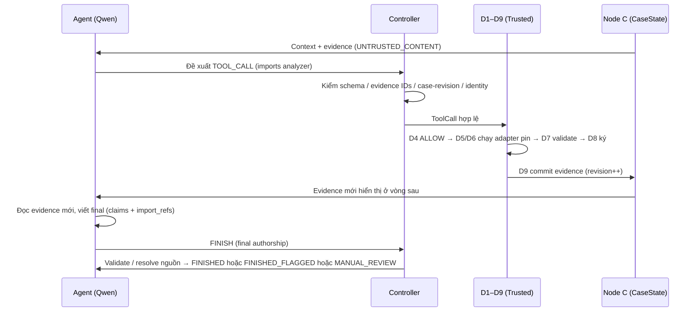

# TASK 06 — Báo cáo tổng kết tuần: AI Agent điều tra mã độc Windows PE

> Phạm vi: từ giai đoạn xây dựng AI Agent (Qwen local), tích hợp bộ phát hiện LightGBM,
> thực nghiệm đánh giá Agent, phát triển điều tra nhiều bước, đến cải thiện độ tin cậy khâu
> kết luận (contract v3.4). Báo cáo tổng hợp **toàn bộ chuỗi phát triển Agent trong tuần**,
> không chỉ TASK 06B-R2. Mọi số liệu đều trích từ artifacts thực nghiệm trong repository.

**Branch:** `feat/task06b-real-multistep-investigation` · **Commit mốc 06B-R2:**
`c8f5c4412649b4eb627c7184d202240611eba274`.

---

## 1. Mục tiêu thực hiện trong tuần

1. Dựng **AI Agent** dùng Qwen3.5:4B chạy local và nối vào lớp điều phối tin cậy D1–D9.
2. Tích hợp **bộ phát hiện mã độc tĩnh** (LightGBM/EMBER2018 v2) vào pipeline xử lý PE.
3. **Đánh giá có kiểm soát** Agent: liệu Agent có tạo giá trị điều tra bổ sung so với báo cáo
   chỉ-dựa-trên-phân-loại-tĩnh, và có bắt được lỗi của detector không.
4. Phát triển **điều tra nhiều bước**: Agent chủ động dùng analyzer, bằng chứng mới được commit
   và Agent đọc lại.
5. **Cải thiện độ tin cậy** của khâu kết luận (structured claims, grounding, bounded retrieval,
   evidence-native contract), giữ fail-safe khi đánh giá không đủ tin cậy.

Nguyên tắc xuyên suốt: **ưu tiên độ chính xác hơn số lượng code / điểm benchmark**; phân biệt rõ
*đã triển khai / đã kiểm thử / chưa hoàn thành*; không phóng đại khả năng phát hiện.

---

## 2. Kiến trúc trước và sau khi phát triển Agent

**Trước (nền tảng, giai đoạn trước — xem README mục "Nền tảng hệ thống"):** Node B (Context
Collector), Node C (CaseState), lớp D1–D9 đã hợp nhất, và một Agent MVP (TASK 04B) mới chỉ chạy
live với **analyzer MOCK**; LightGBM và analyzer thật chưa nối vào vòng điều tra của Agent.

**Sau (tuần này):**
- LightGBM thật được tích hợp: dự đoán ghi vào CaseState cho Agent dùng.
- Agent Qwen thật sinh assessment có cấu trúc, trích dẫn evidence.
- Một analyzer **thật** read-only (`static.pe_imports_detail`) chạy qua D1–D9 trong vòng điều tra.
- Khâu kết luận được thiết kế lại nhiều vòng (v2.1 → v3.3 → v3.4) để giảm lỗi liên kết bằng chứng.

---

## 3. Những công việc chính đã hoàn thành

### 3.1. AI Agent (Qwen local)
Qwen3.5:4B qua Ollama (loopback, không gọi API ngoài), thinking OFF, temperature 0.1, seed cố định,
`num_ctx` 8192, `num_predict` ≤ 2048. Agent sinh structured proposal (`TOOL_CALL`/`FINISH`/
`REQUEST_MORE_EVIDENCE`) và assessment; dữ liệu target gắn `UNTRUSTED_CONTENT`; có giới hạn
iteration/tool/token/thời gian; DENY không được đổi arguments để retry.

### 3.2. Bộ phát hiện mã độc (LightGBM / EMBER2018 v2)
Bộ phân loại độc lập trên feature EMBER2018 v2 (2381 chiều), model đóng băng
(SHA-256 `5db192ec…c509609`), **không** train lại, **không** đổi threshold.

| Chỉ số (tập test 200k có nhãn, không dùng tuning) | Giá trị |
|---|---|
| ROC AUC | 0.992967 |
| Recall / TPR | 0.917100 |
| F1 | 0.951800 |
| False Positive Rate | 0.009980 (≈1%) |
| Threshold (khóa) | 0.83219 |
| Parity với feature space chính thức | AUC ≈ 0.997 |

Raw score **không** phải xác suất hiệu chỉnh. Nguồn: [`research/independent_static_ml/REPORT.md`](../research/independent_static_ml/REPORT.md).

### 3.3. Điều tra nhiều bước (một analyzer thật)
Bổ sung **đúng một** analyzer read-only `static.pe_imports_detail` v0.1.0 (đọc DLL/API/ordinal).
Live với Qwen thật: Agent đề xuất tool → Controller kiểm → D4 ALLOW → D5/D6 chạy adapter đã pin →
D7 validate → D9 commit → revision tăng → Agent đọc evidence mới ở vòng sau.

### 3.4. Cải thiện độ tin cậy khâu kết luận
- **06A:** schema assessment v2.1 (claims kind/text/nguồn) + verifier grounding & consistency.
- **06B-R (v3.3):** bounded retrieval từ evidence đã commit, tách stage chọn-hành-động / viết-final,
  một repair, fail-safe MANUAL_REVIEW.
- **06B-R2 (v3.4):** **evidence-native claims** — mỗi claim tự mang `import_refs`, bỏ mảng binding
  cấp cao và `claim_index`, bỏ ràng buộc literal-in-text; lớp tin cậy chỉ *resolve* entry để hiển thị.

---

## 4. Sơ đồ workflow điều tra nhiều bước

---

## 5. Bảng kết quả thí nghiệm (có nguồn)

### 5.1. Đánh giá có kiểm soát — TASK 05C (`FEATURE_RECORD_REPLAY`, 120 mẫu)
| Hạng mục | Static-only | Static + Agent | Ghi chú |
|---|---|---|---|
| Alignment CONSISTENT | — | **100%** mọi strata | gồm FP 25/25, FN 25/25 |
| Ca CONFLICT trên 50 nhãn-sai (25 FP+25 FN) | — | **0** | Agent không bắt lỗi detector |
| Review-required | 35,8% | 98,3% | Agent gần như luôn đòi review |
| Unsupported-claim | 0% | 0,83% (1/120) | thỉnh thoảng claim ngoài evidence |
| Citation hợp lệ / lỗi schema-timeout | — | 100% / 0 | mặt tích cực |

**Kết luận 05C: PARTIAL** — Agent **không** cải thiện phát hiện, **không** làm bộ lọc lỗi; semantic
PENDING. Nguồn: [`task05c/REPORT.md`](task05c/REPORT.md).

### 5.2. Real benign PE — TASK 05D (`RAW_PE_E2E`, 35 PE)
Pipeline thật chạy trọn vẹn **35/35** PE ký hợp lệ, **0 lỗi, 0 false positive trên tập này**. Nhãn
benign = provenance (OS + Microsoft-signed), độ tin cậy MEDIUM-HIGH, không chứng minh vô hại tuyệt
đối. Malicious raw-PE E2E = **BLOCKED** (chưa có mẫu). Human grading PENDING.
Nguồn: [`task05d/REPORT.md`](task05d/REPORT.md).

### 5.3. Agent v2 structured — TASK 06A (DEV 24 ca)
| Chỉ số | v1 | v2 |
|---|---|---|
| INSUFFICIENT_EVIDENCE | — | 23/24 |
| Decision inconsistency | 5 | **1** |
| Grounding-screen flags | 6 | 8 |

Research PARTIAL. Nguồn: [`task06a/REPORT.md`](task06a/REPORT.md).

### 5.4. Điều tra nhiều bước & độ tin cậy — TASK 06B / 06B-R / 06B-R2
| Chỉ số (DEV 3 PE: tracert/findstr/fc) | 06B-R v3.3 (D) | 06B-R2 v3.4 (DEBUG) |
|---|---|---|
| Analyzer chạy / D9 commit | 3/3 · 3/3 | 3/3 · 3/3 |
| Final hợp lệ cấu trúc, lượt đầu | **0/3** | **3/3** |
| Số repair dùng | 3 (tổng) | **0** |
| Live retrieval được chọn | 0/3 | **1/3** |
| Clean-grounded (unflagged) | 0/3 | **0/3** |
| Trạng thái cuối | MANUAL_REVIEW | FINISHED_FLAGGED → MANUAL_REVIEW |
| Mean E2E (giây) | 40,1 | 23,1 *(confound, xem dưới)* |

v3.4 **loại bỏ lớp lỗi liên kết** (`CLAIM_SOURCE_BINDING`/`CLAIM_LITERAL_MISMATCH`/`claim_index`):
không lỗi nào xuất hiện trong lượt DEBUG. Nhưng cả 3 final bị flag **self-corroboration** (Qwen đưa
prediction vào bằng chứng ủng hộ) → MANUAL_REVIEW. Nguồn: [`task06b/REPORT.md`](task06b/REPORT.md),
[`task06b/REPAIR_REPORT.md`](task06b/REPAIR_REPORT.md), [`task06b/R2_REPORT.md`](task06b/R2_REPORT.md).

> **Confound bắt buộc công bố:** lượt v3.4 chạy độc lập, trong khi v3.3 D chạy xen kẽ nhiều nhánh
> trên cùng một Ollama → chênh lệch latency **một phần do môi trường**, không thuần do thiết kế.
> DEBUG dùng lại đúng 3 file phát triển → **NOT confirmatory**, không suy rộng.

### 5.5. Kiểm thử
`test_v34.py` **26 passed**; task06b suite **99 passed**; full repo regression **649 passed, 4
skipped, 81 subtests** (không drift module v3.3). Phân biệt: Unit / MOCK_LLM / Live Qwen — MOCK
không phải bằng chứng autonomous.

---

## 6. Những cải thiện kỹ thuật đã được chứng minh

1. **Loại bỏ lớp lỗi liên kết bằng chứng từ thiết kế** (v3.4): claim evidence-native thay cho join
   chéo mảng — kiểm chứng bằng 26 test + regression không drift, và DEBUG live first-pass 3/3.
2. **Tách source-resolution khỏi semantic-assertion:** lớp tin cậy resolve entry để hiển thị/
   provenance, không tự viết nhận định — giữ nguyên văn model.
3. **Fail-safe minh bạch:** khi grounding/consistency còn nghi vấn → MANUAL_REVIEW, `final=null` khi
   không có final hợp lệ; không bao giờ gắn `FINISHED` giả.
4. **Bounded retrieval** từ evidence đã commit (không reparse PE, không D9 cho pagination).
5. **Grounding & consistency verifier** xác định, bắt đúng self-corroboration và claim số/entropy.

---

## 7. Vấn đề còn tồn tại

- **Semantic grounding chưa xác nhận độc lập**; rule screen ≠ human judge.
- **Self-corroboration** của Qwen-4B vẫn xảy ra (3/3 DEBUG) → chưa có final clean-grounded.
- **Chưa có confirmatory holdout**; corpus benign đồng nhất, mẫu nhỏ, goal cố định.
- **Human grading PENDING**; malicious raw-PE **BLOCKED** (chưa có mẫu được cấp phép).
- **Chưa** có bằng chứng Agent nâng cao độ chính xác phát hiện mã độc.

---

## 8. Kết quả đạt được và hướng phát triển tiếp theo

**Đạt được:** pipeline PE + LightGBM thật (AUC 0.993); Agent Qwen local sinh assessment có cấu trúc,
trích dẫn hợp lệ; orchestration D1–D9 với provenance; một analyzer imports thật; workflow điều tra
nhiều bước có live demonstration; khâu kết luận v3.4 loại bỏ lớp lỗi liên kết (engineering PARTIAL,
cải thiện có bằng chứng).

**Kết luận nghiên cứu:** **PARTIAL.** Chưa chứng minh Agent tạo giá trị điều tra *grounded* bổ sung
(tất cả final DEBUG bị flag; semantic PENDING; không holdout). "3/3 hợp lệ cấu trúc" là bằng chứng
*engineering* về độ tin cậy khâu finalization, **không** phải research win.

**Hướng tiếp theo (tạm dừng tính năng mới, chưa mở 06C):**
1. Human grading độc lập theo rubric (fact support / query relevance / uncertainty / proportional action).
2. Holdout mù, tách nhãn khỏi prompt/repo trước khi chấm.
3. Khảo sát prompt chống self-corroboration **đo được** (không tuning để che flag).
4. Cân nhắc so sánh model lớn hơn cho nghiên cứu — **không** âm thầm đổi model rồi gán cải thiện cho schema.

---

*Nguyên tắc báo cáo: không che giấu giới hạn; không `success=true` khi validation reject; phân biệt
parser/structural-accepted ≠ clean-grounded ≠ semantic-verified; rule screen ≠ human grading;
MOCK_LLM ≠ live autonomy; DEBUG-trên-DEV ≠ confirmatory.*
