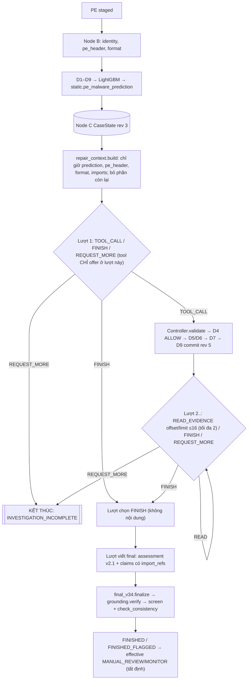
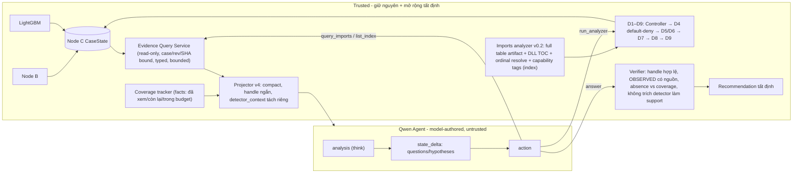
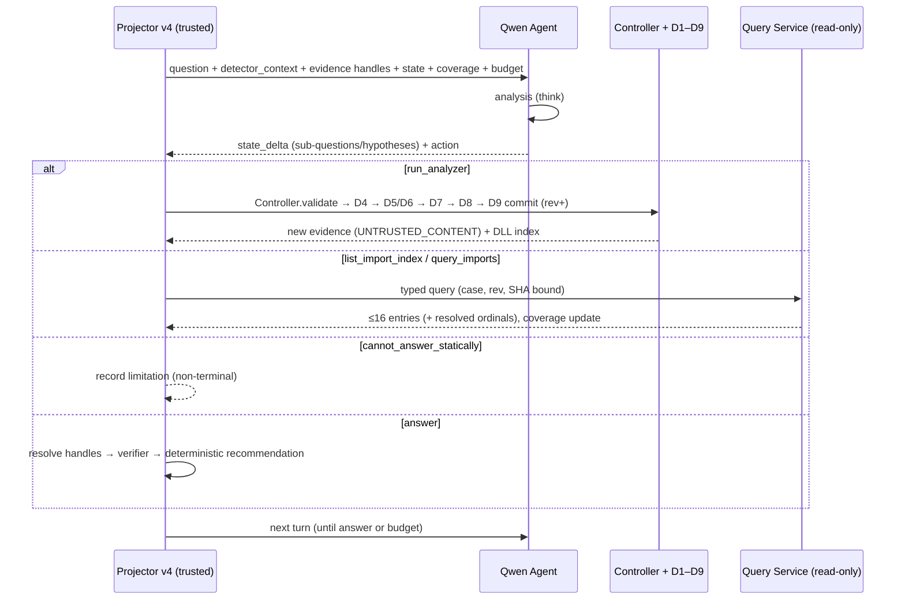

# Independent Architecture Review: năng lực điều tra của AI Agent (DACN-2026)

| Hạng mục | Trạng thái |
|---|---|
| Loại tài liệu | Audit + đề xuất kiến trúc. **Không** sửa code, **không** chạy experiment mới, **không** commit |
| Cơ sở | Git HEAD `e31ee31` (branch `feat/task06b-real-multistep-investigation`, working tree sạch), source `agent/`, `investigation_v3/`, `evaluation/task06a/`, `evaluation/task06b_j/`, raw traces `evaluation/task06b_j/results/confirmatory/run_v1/` |
| Loại bằng chứng | Đọc source; thống kê lại **tất định** trên raw traces đã freeze (chỉ đọc); model card chính thức của Qwen; kiểm tra phần cứng read-only |
| Không dùng | Kết quả Judge làm ground truth; không chạy inference mới. Các con số mới trong báo cáo này là **đếm lại từ trace**, không phải semantic grading |
| Engineering completion | N/A (không implement) |
| Research completion | **PARTIAL**: đã có chẩn đoán nguyên nhân dựa trên trace. Các giả thuyết nhân quả **chưa** được kiểm chứng bằng ablation (xem §14) |

---

## 1. Executive summary

**Câu hỏi:** vì sao Agent gọi được tool nhưng vẫn không điều tra thông minh và đáng tin cậy?

**Kết luận chính:** nút thắt đầu tiên **không phải** Qwen 4B. Nó nằm ở ba quyết định thiết kế,
và cả ba đều thấy được trực tiếp trong source và raw trace:

1. **Contract bắt LLM kiểm chứng nhãn, không bắt nó trả lời câu hỏi điều tra.** Câu hỏi được
   inject theo từng case, nhưng final contract vẫn là contract của TASK 06A:
   - `alignment` với nhãn detector, `supporting_evidence_ids` ("evidence ủng hộ nhãn") và
     `recommendation`;
   - `CONSISTENT` bắt buộc có ít nhất một supporting ID;
   - prediction nằm ngay trong danh sách evidence được phép trích dẫn.

   Với PE benign, thứ "ủng hộ nhãn benign" dễ thấy nhất chính là prediction. Hậu quả:
   - **18/20** final của arm C đặt prediction vào `supporting_evidence_ids`;
   - **8/20** final ghi `INSUFFICIENT_EVIDENCE` nhưng vẫn có supporting IDs, tức model hiểu field
     này là "nguồn tôi đã dùng";
   - **20/20** final đề xuất `MONITOR`.

   Phần lớn structural self-corroboration là **do contract tạo ra**. Không nên coi đó chủ yếu là
   lỗi suy luận của model.
2. **"Agency" thực chất là một phễu cố định.** Trong `workflow_v34.run`:
   - tool chỉ được offer ở **lượt đầu**, và tối đa một lần;
   - READ chỉ có sau khi đã gọi tool, đọc theo offset, tối đa 2 trang;
   - `REQUEST_MORE_EVIDENCE` kết thúc run luôn;
   - FINISH tách thành hai lượt.

   Mỗi case, LLM chỉ chọn ở khoảng 2 điểm rẽ nhánh. Agent không có investigation state, không
   có giả thuyết hay câu hỏi mở được lưu qua các lượt, và không có kế hoạch. Mỗi lượt là một
   projection mới của facts.
3. **Retrieval không có "information scent".** Agent phải đoán offset trên một danh sách import
   xếp theo thứ tự trong file, mà không biết trang nào chứa gì. Kết quả:
   - mọi lần đọc đều bắt đầu ở offset 16, tức đọc tuần tự, không có mục tiêu;
   - **19/20** final của C tự nêu là mới thấy một phần imports, nhưng vẫn dừng khi còn budget
     đọc.

   Agent **nhận ra** khoảng trống nhưng **không hành động** theo nó.

Ngoài ra còn hai yếu tố khuếch đại:

- **Thinking OFF cộng với `action` là token đầu tiên của JSON**, nên quyết định hành động được
  phát ra mà không có bước cân nhắc nào trước đó; `reason` được viết sau, thành ra hợp lý hóa hậu
  kiểm.
- **Context nhiễu:** khoảng 85% ký tự trong facts ở lượt 1 là metadata provenance mà model không
  cần, như SHA, phiên bản extractor, limitations lặp hai lần, hay `unknowns` chứa inode và
  đường dẫn tuyệt đối.

**Model có giới hạn thật**, nhưng là giới hạn thứ cấp:

- thiếu kiến thức miền: không nhận ra `WS2_32` ordinal 115 là `WSAStartup`; không coi
  `fclose`/`fputs` là file I/O;
- khoảng cách giữa biết và làm (knowing–doing gap);
- diễn giải raw score như xác suất.

Chưa có thí nghiệm nào **cô lập** được năng lực model, vì mọi biến kiến trúc ở trên đều đổi cùng
lúc. Thinking OFF được chọn ở TASK 04B do output cap 1536 token (thinking ăn hết cap, content
rỗng) và cap 15 giây/proposal. Thinking **chưa từng** được thử trên workflow v3.4.

**Đề xuất ưu tiên:** giữ toàn bộ lớp tin cậy (Controller, D1–D9, Node B/C, LightGBM) và tạm giữ
Qwen3.5-4B làm baseline, rồi **thiết kế lại phần Agent** thành **investigation v4**: single-agent,
lấy câu hỏi làm trung tâm, có investigation state. Nội dung gồm:

- (a) final contract tập trung vào câu trả lời; detector output tách khỏi namespace evidence được
  trích dẫn;
- (b) suy nghĩ trước, hành động sau (thinking ON, hoặc field `analysis` đứng trước `action`);
- (c) truy vấn có kiểu trên chỉ mục import đầy đủ (DLL table of contents, query theo DLL hoặc
  symbol) thay cho phân trang offset;
- (d) investigation state do Agent tự viết (câu hỏi mở, giả thuyết), còn coverage do trusted
  code tính;
- (e) "cần thêm evidence" không còn là trạng thái kết thúc.

Đổi model (Qwen3.5-9B) chỉ quyết định **sau** khi đã có ablation trên kiến trúc mới.
**Fine-tuning chưa nên làm**: chưa có dữ liệu trajectory, chưa có metric ổn định, và distillation
từ model ngoài vi phạm ràng buộc chỉ dùng LLM local.

Trước khi implement nên chạy **6 ablation nhỏ trên DEV** (§14), dùng metric tất định, không thêm
rubric mới, để phân biệt các giả thuyết nguyên nhân.

---

## 2. Kiến trúc thực tế sau khi audit source

### 2.1 Luồng của arm C trong 06B-J (contract v3.4)



### 2.2 Những điểm then chốt trong code

| Điểm | Vị trí | Hệ quả |
|---|---|---|
| Tool chỉ có khi `result['tool_attempts'] == 0` và không có feedback hay đang finalizing | `investigation_v3/workflow_v34.py:55` | Tool chỉ có ở lượt 1, nên nếu không gọi ngay thì mất cơ hội |
| Mỗi run tối đa 1 tool (`min(1, cfg.max_tool_calls)`) | `workflow_v34.py:126` | Không có chu trình điều tra lặp |
| `REQUEST_MORE_EVIDENCE` dẫn tới `MODEL_REQUESTED_MORE_EVIDENCE` rồi break | `workflow_v34.py:107` | Câu "tôi cần thêm evidence" thành kết thúc không có final. Đây là toàn bộ 13/20 ca incomplete của B |
| Arm B: `range(min(3, max_iterations))`, và prompt v3.4 vẫn mô tả import_refs/READ dù B không có | `workflow_v34.py:47`, `final_v34.SYSTEM` | B và C không tương đương. B được hỏi câu hỏi capability mà không có đường tới imports |
| `GOAL` bị patch theo case, nhưng final contract vẫn là assessment v2.1 (alignment/support/recommendation) | `runner.question()`, `final_v34._assessment` | Câu hỏi và output contract **không khớp nhau** |
| `CONSISTENT` cần ≥ 1 supporting; prediction nằm trong supporting/contradicting thì bị flag | `task06a/consistency.py:110`, `task06a/verification.py:59` | Double-bind (§3.3) |
| Với nhãn benign: `INSUFFICIENT_EVIDENCE` thì `MANUAL_REVIEW`; flag bất kỳ thì `MANUAL_REVIEW` | `consistency.safe_recommendation` | Gần như mọi đường đều thành MANUAL_REVIEW, nên chỉ số "giảm review" không đo được gì |
| Retrieval = offset/limit trên `entries` theo thứ tự trong file; model phải chép `value_sha256` 64 hex | `retrieval.py`, `final_v34.contract` | Đọc mù; gánh nặng sao chép |
| Analyzer commit tối đa 64 entry, đúng thứ tự trong file; ordinal không được resolve | `imports_tool.py`, `import_adapter.py` | 4/20 ca nằm ngoài tầm theo thiết kế; ordinal mạng không đọc được |
| Prompt: `system` (≈2 070 ký tự) + **toàn bộ JSON schema** nối vào system (930–2 750 ký tự) + facts | `agent/planner.py:75` | Tốn token cố định cho schema |
| `num_ctx` hardcode 8192; options chỉ override temperature/seed/num_predict/num_ctx | `agent/planner.py:81` | Prompt lượt cuối 4.7k–6.4k cộng output khoảng 1.1k, sát trần 8192; không còn chỗ cho thinking. `presence_penalty 1.5` từ Modelfile vẫn áp dụng ngầm |
| `think=False` mặc định | `agent/config.py:20` | Model card: Qwen3.5 **mặc định thinking** |

### 2.3 Phân vai thực tế

- **Phần trusted đang làm tốt:** default-deny (D4), target/revision binding, D7 validate, D9
  commit, `UNTRUSTED_CONTENT`, budget, fail-safe MANUAL_REVIEW, và resolve `import_refs` mà không
  bịa nội dung. Phần này **nên giữ**.
- **LLM đang phải gánh:**
  - quyết định hành động mà không có bước cân nhắc;
  - chép ID 32 hex và hash 64 hex;
  - chọn offset mù;
  - quản lý bốn nhóm danh sách ID lặp nhau (`evidence_refs`, `supporting`/`contradicting`,
    `claims[].evidence_ids`, `import_refs`);
  - chọn `alignment` và `recommendation` (dù kết quả cuối được tính lại tất định);
  - viết claim;
  - tự nhớ những gì còn chưa biết. Không có state nào lưu điều này.

---

## 3. Root-cause analysis từ raw traces

Nguồn: `results/confirmatory/run_v1/sample_*_{B,C}.json`. Mọi số dưới đây đếm lại tất định từ
trace đã freeze, không có Judge.

### 3.1 Chuỗi hành động thực tế (C, 20/20)

- Cả 20 case đều bắt đầu bằng `TOOL_CALL` ở lượt 1.
- 14 case đi thẳng TOOL, rồi FIN_SEL, rồi FINISH.
- 6 case có READ:
  - 5 case đọc @16 một lần;
  - 1 case (0002, câu hỏi `NOT_STATIC_ANSWERABLE`) đọc @16 rồi @32.
- **Không lần đọc nào nhảy tới offset có mục tiêu.**
- Lớp `REACHABLE_BY_BOUNDED_RETRIEVAL` (0003, 0012, 0013, 0016, 0018, 0019):
  - chỉ 0003 và 0018 có đọc;
  - 0003 thấy `WS2_32` ordinal 115/11 ở entry 30–31, đây là ca 1/6 duy nhất;
  - 0018 đọc @16 trong khi `WriteFile` nằm ở entry 47, nên trượt.
- Ngược lại, 0002, 0007, 0011, 0020 (câu hỏi không trả lời được bằng static, hoặc evidence nằm
  ngoài tầm) lại được đọc.

Việc đọc **không tương quan** với nhu cầu của câu hỏi.

### 3.2 Knowing–doing gap

**19/20** final của C có câu kiểu *"Only 16 of 64 committed import entries are visible; absence …
is unknown"*, nhưng `retrieval_attempts < 2` (đếm bằng regex trên assessment; đây là ước lượng
xấp xỉ).

Ví dụ 0012 (câu hỏi file-system, `msvcrt!fopen` ở entry 21):

- lượt 2, model chọn FINISH và tự viết "Static imports show only 16 of 64 committed entries … none
  explicitly declaring standard file I/O APIs";
- trang 0–15 đang hiển thị lại có `fclose`, `fputs`, `fflush`, đều là file-stream I/O của CRT.

Ca này có **hai lỗi chồng lên nhau:**

- (a) không đọc tiếp, dù chính model nói mình mới thấy một phần (lỗi hành động/kiến trúc);
- (b) không nhận ra API CRT là file I/O, vì neo vào tên Win32 `CreateFile` (lỗi kiến thức miền
  của model).

Ở 0003, model thấy `WS2_32` ordinal 115 và 11 nhưng viết "symbol names are null; specific API
usage cannot be confirmed". Theo bảng ordinal chuẩn của ws2_32, 115 là `WSAStartup`, 11 là
`inet_addr`. Resolve ordinal của DLL hệ thống là **việc tất định của analyzer**, không nên giao cho
LLM.

### 3.3 Structural self-corroboration do contract tạo ra

Có ba điều kiện cùng lúc:

1. `CONSISTENT` không có supporting thì bị flag `alignment_consistent_not_justified_by_structure`;
2. supporting chứa prediction thì bị flag `prediction_used_as_own_corroboration`;
3. `INSUFFICIENT_EVIDENCE` vẫn cho ra `MANUAL_REVIEW`.

Với PE benign mà chỉ có header, format và prediction (arm B), hoặc imports của tiện ích hệ thống
(vốn không "ủng hộ benign" theo nghĩa chặt), lối thoát duy nhất là `CONSISTENT` cộng supporting =
header/format. Đây là một lập luận yếu, nhưng là lập luận duy nhất mà contract không phạt.

Trace cho thấy model diễn giải field theo nghĩa khác:

- **8/20** final ghi `INSUFFICIENT_EVIDENCE` nhưng supporting vẫn khác rỗng;
- **18/20** final có prediction trong supporting.

Nói cách khác, `supporting_evidence_ids` đang được model dùng như "các nguồn tôi đã dựa vào".
Đây là **lỗi semantic của schema**: tên field mơ hồ, lại được định nghĩa tương đối với nhãn.
Chiều semantic (Judge 7–12/20) là một phần riêng, nhỏ hơn, và vẫn cần human adjudication.

### 3.4 Lý do gọi tool ở 8/8 ca không cần

Đọc `reason` ở lượt 1 của các ca `INITIAL_EVIDENCE_SUFFICIENT` (câu hỏi "PE loại gì, detector
nói gì"):

- 0001: "To determine if the binary relies on dynamic APIs or contains obfuscated import
  resolution…"
- 0009: "…lack import details to verify specific capabilities or rule out evasion."
- 0015: "…detect obfuscation techniques…"

Model **thay câu hỏi bằng nhiệm vụ ngầm "đánh giá có độc hay không"**. Nhiệm vụ ngầm này đến từ:

- system prompt v3.4, vốn xoay quanh imports;
- contract alignment/recommendation;
- tool chỉ offer ở lượt 1, nên không gọi ngay là mất;
- prior từ quá trình post-training cho tác vụ agentic: có tool thì dùng.

### 3.5 Arm B incomplete 13/20

Cả 13 ca đều là `REQUEST_MORE_EVIDENCE` ngay lượt 1, không có lỗi schema hay truncation. Lý do
model đưa ra **đúng về bản chất** (câu hỏi capability, không có imports). Ví dụ 0008: "requires
visibility into declared imports (e.g., CreateProcess, OpenProcess)".

Có một lỗi context đi kèm: model suy diễn rằng `omitted_evidence_ids` chứa imports ("The
'omitted_evidence_ids' list indicates committed imports exist", 0005 và 0012). Projection liệt kê
ID của evidence bị bỏ mà không nói chúng là gì, nên model tự bịa nghĩa cho chúng.

Kết luận: **B không thất bại vì kém thông minh.** B bị đặt vào một workflow coi việc xin thêm
evidence là kết thúc, và được hỏi những câu cần đúng thứ mà B bị cấm có.

### 3.6 Định dạng và chi phí context

Arm B, lượt 1:

- facts khoảng 5 450 ký tự, trong đó phần cần cho câu hỏi (label, score, threshold, pe_header,
  format, question) khoảng 800, tức khoảng 15%;
- system khoảng 2 070 ký tự, schema khoảng 930 (lượt final: khoảng 2 750);
- prompt khoảng 3 050 token cho **3** evidence.

Phần thừa gồm:

- `model_sha256`, `extractor`, `lief_version`;
- `full_detail_ref` có SHA;
- `limitations` lặp ở cả `value` lẫn ngoài `value`;
- `unknowns` chứa `target_ref` đầy đủ (device, inode, mtime, path tuyệt đối);
- `observed_in_case_revision`, `commit_revision: null`.

Prediction đứng **đầu** danh sách evidence (thứ tự sort trong `context.build_context`), nên tạo
anchoring ngay từ đầu.

---

## 4. Phân loại lỗi

| Lỗi quan sát | Model | Kiến trúc / workflow | Context | Retrieval / analyzer | Contract / validation | Bằng chứng |
|---|---|---|---|---|---|---|
| Gọi tool khi không cần (8/8) | phụ (prior agentic, không cân nhắc) | **chính** (tool chỉ ở lượt 1, action-first) | **chính** (prompt xoay quanh imports) | — | phụ (framing malware) | §3.4 |
| Không đọc tiếp dù biết thiếu (19/20) | **chính** (knowing–doing gap) | **chính** (không có state câu hỏi mở, FINISH rẻ) | — | **chính** (không có scent) | — | §3.1, §3.2 |
| Nhầm danh sách một phần là toàn bộ (DEV) | phụ | — | phụ | **chính** (cap 64, file-order) | — | R2_REPORT RC5, §3.2 |
| Không nhận ra API liên quan (CRT, ordinal) | **chính** (kiến thức miền) | — | phụ (không có annotation) | **chính** (không resolve ordinal) | — | 0012, 0003 |
| Self-corroboration structural (18/20) | phụ | — | phụ (prediction là evidence citable, đứng đầu) | — | **chính** (định nghĩa supporting/CONSISTENT) | §3.3 |
| Self-corroboration semantic (7–12/20, Judge) | **chính** | — | phụ (score hiện nhiều chữ số) | — | phụ | CONFIRMATORY §4 |
| Coi score là xác suất, runtime overclaim | **chính** | — | phụ | — | — | Judge tags SCORE_AS_PROBABILITY 8/4 |
| B incomplete 13/20 | không | **chính** (REQUEST_MORE là terminal, arm không tương đương) | phụ (`omitted_evidence_ids` gây hiểu sai) | — | — | §3.5 |
| Thiếu kế hoạch kiểm chứng tiếp theo | phụ | **chính** (không có state) | — | — | **chính** (không có field next-step, maxItems 4 claims) | R9 |
| Không có structured final (DEV v3.3) | phụ | — | — | — | **chính** (RC1–RC3, đã sửa ở v3.4) | R2_REPORT |
| `MONITOR` 20/20 bất kể alignment | phụ | — | — | — | **chính** (LLM không nên chọn recommendation) | §1 |

Hai thứ **không** phải nguyên nhân trong confirmatory: lỗi schema hay JSON (0 lỗi validation, 0
truncation) và budget token.

---

## 5. Những điều đang làm sai về mặt thiết kế Agent

1. **Định nghĩa nhiệm vụ sai từ gốc.** Từ 05C (CONSISTENT 100%), qua 06A, tới 06B-J (MONITOR
   20/20), contract luôn hỏi "evidence có khớp nhãn không". Đó là nhiệm vụ *explain-the-detector*.
   Mục tiêu dài hạn của dự án là *investigate-the-file*. Mỗi task đều sửa schema hoặc validator
   xung quanh lõi này, nhưng chưa task nào đổi chính lõi.
2. **Nhầm "có tool" với "có agency".** Agency cần không gian hành động lặp được, cần state, và cần
   quyền dừng hay tiếp tục dựa trên tiến độ so với mục tiêu. v3.4 có tool nhưng không có ba thứ
   này.
3. **Tối ưu cho tính hợp lệ cấu trúc.** Phần lớn effort đi vào chống lỗi binding, literal và
   repair (RC1–RC6), là những lỗi do chính contract phức tạp sinh ra. Contract càng phức tạp thì
   càng nhiều lỗi định dạng, rồi lại cần thêm validator.
4. **Đặt quyết định trước suy nghĩ.** JSON bắt đầu bằng `action`, thinking OFF, và quyết định
   được đưa ra mà không có bước cân nhắc nào trước đó.
5. **Bắt LLM làm việc tất định:** chép hash, đếm entry, nhớ coverage, resolve ordinal, chọn
   recommendation. Trusted code nên làm những việc này, và việc đó không vi phạm nguyên tắc ownership
   vì đây là facts, không phải claim.
6. **Ngược lại, hardcode những gì nên để Agent quyết định:** gọi tool khi nào (chỉ ở lượt 1), bao
   nhiêu lần, và đọc gì (offset thay vì truy vấn theo nhu cầu).
7. **Cohort đánh giá gần như không có headroom.** Với 20 tiện ích Windows benign đã ký, câu trả lời
   đúng phần lớn là "khai báo capability X; không có gì bất thường; không xác định được runtime".
   Giá trị điều tra thật (bắt lỗi detector, phân tích ca mơ hồ) không thể hiện được trên tập này.

---

## 6. So sánh các phương án

### 6.1 Option 1: giữ Qwen 4B, cải thiện prompt và context

- **Làm được:**
  - bỏ khoảng 85% nhiễu trong context;
  - dùng handle ngắn (`E1`, `I:KERNEL32#12`) để trusted code resolve thay cho chép ID 32 hex;
  - đặt `analysis` trước `action`;
  - tách prediction khỏi evidence citable;
  - viết system prompt bám theo câu hỏi.
- **Không làm được:**
  - Option 1 không tạo ra state hay information scent;
  - nó cũng không sửa được tool chỉ-ở-lượt-1 và REQUEST_MORE là terminal, vì đó là workflow chứ
    không phải prompt.
- **Đánh giá:** cần thiết nhưng không đủ. Chi phí thấp, nên là một phần của phương án chọn.

### 6.2 Option 2: model lớn hơn hoặc phù hợp hơn

Số liệu từ model card chính thức Qwen3.5 (bảng **không ghi rõ** thinking hay non-thinking; card
nói Qwen3.5 mặc định chạy thinking):

| Benchmark | Qwen3.5-4B | Qwen3.5-9B | Ý nghĩa với dự án |
|---|---:|---:|---|
| BFCL-V4 (function calling) | 50.3 | 66.1 | 9B tốt hơn rõ về gọi hàm và binding đối số |
| TAU2-Bench (agent, tool) | 79.9 | 79.1 | Tương đương |
| DeepPlanning | 17.6 | 18.0 | **Cả hai đều thấp**; tăng kích thước gần như không cải thiện planning |
| IFBench | 59.2 | 64.5 | 9B tuân thủ ràng buộc tốt hơn vừa phải |
| LongBench v2 | 50.0 | 55.2 | 9B hơn vừa phải |
| Context gốc | 262 144 | 262 144 | Repo đang chạy `num_ctx` 8192 |

- **Phần cứng** (kiểm read-only): RTX 3070 **8 GB VRAM**, 32 GB RAM, i5-14400F; Ollama 0.40.16;
  `qwen3.5:4b` Q4_K_M, 3.3 GB, có vision projector khoảng 334M.
  - 9B ở Q4 về lý thuyết vừa 8 GB khi context vừa phải, nhưng **phải đo** VRAM thật với
    `num_ctx` 16k trước khi kết luận.
  - Model từ khoảng 27B trở lên phải offload CPU, quá chậm cho vòng lặp nhiều lượt.
- **Đánh giá:**
  - 9B có thể giảm lỗi binding và hiểu tên field tốt hơn, và có thể có nhiều kiến thức miền hơn;
  - benchmark planning cho thấy chỉ đổi model **sẽ không** giải quyết phễu cố định hay retrieval
    mù;
  - latency 9B ước chừng 1.8–2.5 lần 4B (chưa đo).
  - Chỉ nên so sánh 9B với 4B **trên cùng kiến trúc v4** (E7).

### 6.3 Option 3: thinking hoặc reasoning mode

- **Lịch sử:**
  - TASK 04B tắt thinking vì ở cap 1536 token, thinking chiếm hết output nên content rỗng, và vì
    cap 15 giây/proposal;
  - với v3.4 (`num_predict` 2048, timeout 90 giây) thinking chưa từng được thử.
- **Lợi ích kỳ vọng:**
  - có bước cân nhắc trước quyết định, nhắm thẳng vào knowing–doing gap và việc gọi tool phản
    xạ;
  - tài liệu cho thấy ràng buộc định dạng làm giảm suy luận, và cách khắc phục được nhắc nhiều
    nhất là tách phần suy luận khỏi phần định dạng (Tam et al. 2024; arXiv 2604.03616). Cũng có
    nghiên cứu phản biện (arXiv 2610.35328), nên hiệu ứng **phải đo**.
- **Chi phí:**
  - thêm vài trăm đến vài nghìn token mỗi lượt;
  - phải nâng `num_ctx` (8192 đã sát trần) và `num_predict`;
  - phải xác minh Ollama 0.40 xử lý đúng `think=true` cùng `format` (thinking sinh tự do, sau đó
    content bị ràng buộc).
- **Phương án rẻ hơn:** giữ think OFF nhưng thêm field `analysis` **đứng trước** `action` trong
  JSON. Đây chính là ablation E2.
- **Đánh giá:** chi phí thấp nhất, giá trị chẩn đoán cao nhất. Phải chạy trước mọi thay đổi khác.

### 6.4 Option 4: thiết kế lại kiến trúc Agent

| Mẫu | Phù hợp? | Lý do |
|---|---|---|
| ReAct (suy nghĩ, hành động, quan sát, lặp lại) | **Có, làm lõi** | Sửa trực tiếp lỗi action-first; mỗi lượt chỉ cần một quyết định nhỏ, hợp với model 4B |
| Plan-and-execute có replan | **Có, ở dạng nhẹ** | Lượt đầu Agent viết các câu hỏi con; mỗi lượt sau cập nhật. Không cần LLM planner riêng |
| Hypothesis-driven | **Có**, nằm trong state | Giả thuyết kèm trạng thái `OPEN/SUPPORTED/WEAKENED/UNRESOLVABLE_STATICALLY` |
| Blackboard / shared state | **Có**, nhưng chỉ do một Agent viết | State là model-authored, lưu kèm attribution; coverage do trusted code tính |
| Bounded search | Có | Budget truy vấn thay cho "tối đa 2 trang" |
| Reflection hoặc verification bằng LLM thứ hai | **Không, lúc này** | Gấp đôi số lần gọi trên model 4B, có rủi ro self-grading; thay bằng phản hồi coverage tất định |
| Multi-agent (planner, executor, critic) | **Không** | Context nhỏ, một analyzer, nút thắt không nằm ở việc phân vai. CHASE dùng supervisor để tránh context confusion trên tác vụ lớn hơn nhiều; tác vụ ở đây chưa tới mức đó |

### 6.5 Option 5: thiết kế lại retrieval

- **Tách ba loại:**
  - (1) *retrieval tất định*: truy vấn có kiểu trên evidence đã commit;
  - (2) *annotation tất định*: resolve ordinal, gắn thẻ họ capability theo một lexicon có phiên
    bản, giống mục lục thư viện;
  - (3) *suy luận semantic*: việc của Agent.
- **Đề xuất:**
  - analyzer commit **toàn bộ** import table, đặt trong artifact giới hạn byte;
  - analyzer commit thêm DLL table of contents (tên DLL, số entry, khoảng index);
  - Agent truy vấn bằng `query_imports{by: DLL|SYMBOL_PREFIX|CAPABILITY_TAG, value}`, mỗi lần trả
    ≤ 16 entry.
- **Chống biến thành if-else:**
  - Agent tự chọn truy vấn gì;
  - tag chỉ là chỉ mục để tìm, không phải kết luận;
  - claim phải trích **entry**, không được trích tag;
  - ablation có tag và không tag (E3) đo xem tag giúp ích hay chỉ làm mồi gợi ý.
- **Semantic retrieval bằng embedding:** không cần lúc này. Không gian truy vấn nhỏ và có cấu
  trúc; embedding sẽ thêm model phụ mà không tăng khả năng audit.

### 6.6 Option 6: fine-tuning Qwen

| Câu hỏi | Trả lời |
|---|---|
| Train cái gì? | Chính sách hành động (khi nào truy vấn, truy vấn gì, khi nào dừng) và cách viết claim có trích nguồn trên **contract v4** |
| Objective | SFT trên trajectory tốt; sau đó có thể dùng DPO trên cặp tốt/xấu (ví dụ đọc tiếp khi thiếu và dừng sớm) |
| Dữ liệu | Trajectory (state, hành động, quan sát) cộng final. Nguồn khả thi: rejection sampling chính Qwen 4B/9B local, lọc bằng reward tất định (có thấy entry liên quan không, absence claim có đúng so với bảng import đầy đủ evaluator-only không). Cộng 50–100 trajectory do người viết |
| Distillation từ model mạnh | **BLOCKED theo CLAUDE.md**: không dùng LLM API ngoài; nội dung PE không được gửi ra ngoài. Teacher local ≥ 27B trên phần cứng này chỉ chạy được vài token/giây, không thực tế |
| Tài nguyên | QLoRA 4B trên 8 GB khả thi về lý thuyết; 9B thì sát giới hạn. Chưa đo |
| Rủi ro overfit | Hiện chỉ có 1 analyzer, 1 workflow, PE benign hệ thống; malicious raw-PE BLOCKED. Fine-tune lúc này sẽ học thuộc một phễu và một contract sắp thay |
| Làm sao biết fine-tune tốt hơn redesign | Chỉ so được khi kiến trúc đã ổn định và có metric tất định ổn định. Cả hai điều kiện hiện **chưa** có |

**Kết luận:** chưa làm. Chỉ cân nhắc khi cả hai điều sau đều đúng: (a) kiến trúc v4 đã ổn định;
(b) E7 cho thấy model là nút thắt còn lại.

### 6.7 Option 7: hybrid

Phương án được chọn là một hybrid có thứ tự rõ ràng (§8).

### 6.8 Ma trận so sánh

Thang: ↑↑ tốt nhiều, ↑ tốt, ≈ không đổi, ↓ xấu đi. "Khả thi đồ án" xét trên 8 GB VRAM và quỹ thời
gian còn lại.

| Tiêu chí | O1 Prompt/context | O2 Model 9B | O3 Thinking / reason-first | O4 Kiến trúc v4 | O5 Retrieval có chỉ mục | O6 Fine-tune | **O7 Hybrid đề xuất** |
|---|---|---|---|---|---|---|---|
| Chất lượng suy luận | ↑ | ↑ | ↑ (cần đo) | ↑ | ≈ | ↑? (chưa có dữ liệu) | ↑↑ |
| Tính tự chủ điều tra | ≈ | ≈ | ↑ | ↑↑ | ↑ | ↑? | ↑↑ |
| Evidence grounding | ↑ | ↑ | ↑ | ↑ | ↑↑ | ↑? | ↑↑ |
| Bảo mật | ≈ | ≈ | ≈ | ≈ (giữ D1–D9) | ≈ (đọc CaseState, typed) | ≈ | ≈ |
| Latency | ↑ (prompt ngắn hơn) | ↓ (khoảng 2×) | ↓ | ≈/↓ (nhiều lượt hơn) | ↑ (ít lượt đọc mù) | ≈ | ≈/↓ |
| Yêu cầu phần cứng | không đổi | 8 GB, sát giới hạn | không đổi | không đổi | không đổi | GPU train 4B | không đổi (9B tùy chọn) |
| Độ phức tạp engineering | Thấp | Thấp | Thấp | Trung bình | Trung bình | Cao | Trung bình |
| Giá trị nghiên cứu | Thấp | Trung bình | Cao (ablation rõ) | Cao | Cao | Trung bình | **Cao** |
| Khả năng hoàn thành trong đồ án | Cao | Cao | Cao | Trung bình–cao | Trung bình–cao | **Thấp** | Trung bình–cao |

---

## 7. Đánh giá khả thi trên phần cứng hiện tại

- **Inference 4B:**
  - Q4_K_M 3.3 GB; nâng `num_ctx` lên 16k là khả thi;
  - có thể thử Q8_0 (khoảng 4.5–5 GB) để kiểm giả thuyết lượng tử hóa, nếu owner cho phép tải
    model. Báo cáo này **không** tải.
- **Inference 9B:** có thể vừa 8 GB ở Q4. Cần đo VRAM, tốc độ token và latency trước khi đưa vào
  thí nghiệm.
- **Latency:**
  - hiện tại C trung bình 20.5 giây/case;
  - v4 thêm vài lượt và có thể bật thinking, nên ước lượng 30–90 giây/case với 4B;
  - vẫn chấp nhận được cho nguyên mẫu nghiên cứu, nhưng cần nới `wall_clock_s` 180 trong harness.
- **Dữ liệu không cần binary malware:** bản ghi EMBER2018 raw trên `D:\datasets\ember2018-v2\`
  (đã kiểm bản ghi đầu tiên) có `imports` theo DLL đầy đủ, `exports`, `section`, `strings`,
  `header`, `datadirectories`.
  - Dùng track `FEATURE_RECORD_REPLAY` có thể thử Agent trên **mẫu malicious và ca detector sai
    (FP/FN)** mà không chạm vào binary, và không cần analyzer imports.
  - `label` và `avclass` là **evaluator-only**, phải loại khỏi prompt; `_assert_no_ground_truth` đã
    có.

---

## 8. Kiến trúc đề xuất: investigation v4

Đây là single-agent, lấy câu hỏi làm trung tâm, có investigation state. Lớp tin cậy giữ nguyên.

### 8.1 Nguyên tắc

1. **Nhiệm vụ là trả lời câu hỏi điều tra**, không phải xác nhận nhãn. Nhãn detector là
   *context*, không phải evidence.
2. **Suy nghĩ trước, hành động sau, mỗi lượt một bước nhỏ.**
3. **Agent tự viết state** (câu hỏi mở, giả thuyết, kế hoạch). **Trusted code tính facts về
   state** (coverage: đã xem gì, còn gì, trong tầm budget hay không).
4. **Truy vấn có mục tiêu** thay cho đọc mù. Chỉ mục do analyzer cung cấp; truy vấn do Agent chọn.
5. **Việc tất định thuộc về trusted code**, gồm resolve handle, resolve ordinal, đếm,
   recommendation, provenance. Chỉ **resolve**, không bao giờ viết claim thay model.
6. **Xin thêm evidence không phải là kết thúc.** Không lấy được evidence thì đó là giới hạn được
   ghi lại, và Agent vẫn phải trả lời với phần đang có.

### 8.2 Thành phần



### 8.3 Không gian hành động (contract `investigation-v4.0`, opt-in)

| Action | Ý nghĩa | Kiểm soát |
|---|---|---|
| `run_analyzer{tool}` | Chạy analyzer đã đăng ký | Controller → D4 default-deny, binding SHA/revision; offer **ở mọi lượt** tới khi đã chạy; dedupe như hiện tại |
| `list_import_index{}` | Xem mục lục DLL (tên, số entry, khoảng index, tag) | Đọc CaseState đã commit, giới hạn byte |
| `query_imports{by, value}` | `by ∈ {DLL, SYMBOL_PREFIX, CAPABILITY_TAG}`; `value` ≤ 64 ký tự, so khớp literal, không regex; ≤ 16 entry | Chỉ đọc evidence đã commit; target/revision bound; không path; không tạo evidence mới |
| `answer{...}` | Final (§8.4) | Verifier tất định |
| `cannot_answer_statically{need}` | Nêu evidence cần mà hệ thống không có (runtime, unpacking, chữ ký…) | **Không** terminal: chuyển thành limitation, rồi Agent viết `answer` |

Mỗi lượt có ba phần theo thứ tự: `analysis` (tự do; hoặc native thinking), rồi `state_delta`, rồi
`action`. Agent không còn phải chép `value_sha256` hay ID 32 hex; chỉ dùng handle như `E2`,
`I:KERNEL32#40`. Trusted code ánh xạ handle sang ID thật và ghi vào trace.

### 8.4 Final contract tập trung vào câu trả lời

```json
{
  "answer_status": "ANSWERED | PARTIALLY_ANSWERED | NOT_STATICALLY_ANSWERABLE",
  "answer": "…",
  "findings": [{"kind": "OBSERVED|INFERENCE|LIMITATION", "text": "…", "sources": ["I:KERNEL32#40"]}],
  "open_questions": ["…"],
  "next_verification": ["…"],
  "detector_relation": {"value": "AGREES|CONFLICTS|NOT_INFORMATIVE", "basis_sources": ["I:…"]}
}
```

- **Bỏ khỏi LLM:**
  - `recommendation`: đã được tính lại tất định, và model chọn `MONITOR` 20/20;
  - `supporting_evidence_ids` theo nhãn;
  - bốn nhóm danh sách ID lặp nhau.
- **Detector:**
  - nằm trong khối `detector_context`, **không** có handle citable;
  - `basis_sources` không thể trỏ vào detector, nên self-corroboration structural bị loại bỏ
    ngay bằng cấu trúc contract;
  - semantic self-corroboration vẫn cần chấm.
  - Nếu câu hỏi hỏi về detector, `answer` thuật lại output detector, và verifier đối chiếu
    literal.
- **Verifier tất định giữ ý định của v3.4:**
  - OBSERVED phải có nguồn;
  - claim absence bị flag nếu coverage của DLL hay họ đó chưa đầy đủ (trusted code biết chính xác
    phần đã xem);
  - flag entropy, xác suất, score.
- Contract này là phiên bản **mới, có version, opt-in**. v3.4 giữ nguyên và frozen.

### 8.5 Investigation state

| Trường | Ai viết | Ghi chú |
|---|---|---|
| `sub_questions[]` (id, text, status) | Agent | Lượt đầu tách câu hỏi thành câu hỏi con |
| `hypotheses[]` (text, status, sources) | Agent | Status do Agent cập nhật |
| `coverage` (DLL nào đã xem hết hay một phần, entry đã thấy, còn bao nhiêu budget truy vấn) | **Trusted** | Facts tính từ log truy vấn |
| `budget` (lượt, truy vấn, thời gian còn lại) | **Trusted** | Như hiện tại |

State nằm trong trace của run với attribution `MODEL_AUTHORED`. Nó **không** ghi vào Node C như
trusted evidence. Nếu cần persist thì đi qua D9, dưới namespace model-authored.

**Phản hồi khi dừng:** khi Agent chọn `answer` trong lúc còn câu hỏi con `OPEN` và coverage cho
thấy còn dữ liệu trong tầm, projector đưa vào **một dòng facts**, ví dụ "sub-question Q2 open;
KERNEL32 has 34 unviewed entries; 3 queries remain". Agent vẫn tự quyết. Đây là thông tin, không
phải ép buộc; metric "tỷ lệ hành động theo phản hồi" (E5) đo hiệu quả của nó.

### 8.6 Tại sao không cần multi-agent

- Context mỗi lượt nhỏ (khoảng 1–2k token sau khi nén), một analyzer, một câu hỏi.
- Thêm vai planner hoặc critic sẽ nhân số lần gọi model 4B, tăng latency, và không giải quyết
  bất kỳ nguyên nhân nào ở §4.
- Phản biện bằng LLM thứ hai trên cùng họ model mang rủi ro self-grading.

---

## 9. Workflow v4



Giới hạn đề xuất cho DEV (để ablation tự chỉnh, không khóa trước): 8 lượt, 1 lần chạy analyzer, 6
truy vấn, 16 entry mỗi truy vấn, `num_ctx` 16k. Khi budget hết mà chưa có `answer`, có **một lượt
final bắt buộc** với dữ liệu đang có, thay cho trạng thái INCOMPLETE.

---

## 10. Walkthrough minh họa: case kiểu 0012

> Phần **v3.4** dưới đây là trace thật. Phần **v4** là **minh họa thiết kế**, không phải kết quả
> chạy.

- **Input:** PE x64, LightGBM benign, raw 0.002.
- **Câu hỏi:** "What does the available static evidence indicate about this file's capability for
  file-system access…?"
- **Imports:** 111 entry, 64 được commit; trang 0–15 toàn `msvcrt` (`fclose`, `fputs`, `fflush`…);
  `fopen` ở entry 21.

**v3.4 (thực tế):**

1. TOOL_CALL.
2. FIN_SEL: "only 16 of 64 visible, none explicitly file I/O".
3. FINISH:
   - `CONSISTENT`, supporting gồm imports và prediction;
   - claim "no direct file-system APIs";
   - flag self-corroboration, dẫn tới MANUAL_REVIEW.

**v4 (minh họa):**

1. **Lượt 1.**
   - `analysis`: "Question is about file-system capability. No import evidence yet. Header alone
     cannot answer."
   - `state_delta`: Q1 "Are file-creation/read/write APIs declared?" OPEN; Q2 "Can static
     evidence show actual file access at runtime?" (dự kiến: không).
   - `action`: `run_analyzer`.
   - Kết quả: D4 ALLOW, D9 commit; projector hiện DLL index:
     `msvcrt.dll 0–58 (59)`, `KERNEL32.dll 59–102 (44)`, `ntdll.dll 103–110 (8)`; tags `FILE` có
     ở msvcrt và KERNEL32.
2. **Lượt 2.**
   - `analysis`: "Both msvcrt and KERNEL32 have FILE-tagged entries; check CRT file APIs first."
   - `action`: `query_imports{by: CAPABILITY_TAG, value: FILE}`.
   - Trả về các entry như `msvcrt!fopen #21`, `fclose #8`, `fputs #5`, `KERNEL32!CreateFileW …`
     (≤ 16).
3. **Lượt 3.**
   - `state_delta`: Q1 thành SUPPORTED (sources `I:msvcrt#21`, `I:msvcrt#8`); Q2 thành
     UNRESOLVABLE_STATICALLY.
   - Coverage: tag FILE đã xem hết, nên Agent được phép kết luận về *khai báo*.
   - `action`: `answer`.
4. **Final:**
   - `PARTIALLY_ANSWERED`;
   - OBSERVED: "declares CRT stream I/O (fopen, fclose, fputs) and Win32 CreateFileW";
   - LIMITATION: "declared ≠ executed; dynamic resolution not visible";
   - `next_verification`: "dynamic trace or decompiled call-sites of fopen";
   - `detector_relation`: `NOT_INFORMATIVE`.
5. **Trusted:**
   - resolve handle;
   - verifier: OBSERVED có nguồn, không có claim absence;
   - recommendation tất định (benign, không có flag) là `MONITOR`.

Điều đáng chú ý ở walkthrough này nằm ở chỗ khác, không phải ở việc tag "thông minh". Agent biết
**có gì ở đâu** (scent), **ghi nhớ** câu hỏi chưa xong (state), và **suy nghĩ trước khi chọn**.
Ablation E3 phải đo xem tag có làm Agent chỉ chạy theo tag mà không suy luận hay không.

---

## 11. Những component nên giữ nguyên

- Controller, D1–D9: default-deny, binding, D7, D8, D9, ledger.
- Node B và Node C; LightGBM, threshold và model đã khóa.
- `UNTRUSTED_CONTENT` / `UNTRUSTED_CASE_DATA`; `_assert_no_ground_truth`.
- Fail-safe MANUAL_REVIEW, recommendation tất định, `NOT_EXECUTED_CONTAINMENT`.
- Ý tưởng của v3.4 là "trusted chỉ resolve tham chiếu model đã chọn". v4 mở rộng ý này thành handle
  ngắn.
- Hạ tầng đánh giá 06B-J: runner 3 arm, staging trung tính, write-once, freeze, blind package,
  Judge kit. Tái sử dụng, **không** mở rộng rubric.
- v3.3 và v3.4 frozen, dùng làm baseline.

## 12. Những component cần redesign

| Component | Thay đổi |
|---|---|
| `final_v34` contract | Contract `investigation-v4.0` tập trung vào câu trả lời (§8.4) |
| `workflow_v34` loop | Vòng ReAct có state; tool offer ở mọi lượt; xin thêm evidence không terminal; lượt final bắt buộc khi hết budget |
| `repair_context` / `context` projection | Nén mạnh; handle ngắn; `detector_context` tách khỏi evidence citable; bỏ `omitted_evidence_ids` thô (thay bằng "N evidence không liên quan đã bị lược") |
| `retrieval.fetch` (offset) | Query service có kiểu (DLL / prefix / tag) cộng DLL index |
| Imports analyzer v0.1 | v0.2: full table dưới dạng artifact giới hạn byte, DLL TOC, resolve ordinal của DLL hệ thống phổ biến, tag theo lexicon có phiên bản (annotation, không phải kết luận). Thay đổi D7 validator đi kèm |
| `agent/planner.py` | `num_ctx` cấu hình được; pin rõ `presence_penalty`; hỗ trợ thinking cùng `format` (đã xác minh) |
| Thiết kế arm đánh giá | Arm B phải có đường trả lời có giới hạn (non-terminal); so sánh B với C theo câu hỏi tương đương |

## 13. Có cần đổi model hoặc fine-tune không?

- **Đổi model: chưa.**
  - Bằng chứng hiện có không cho thấy 4B là nút thắt đầu tiên: 0 lỗi schema; lý do gọi tool và
    xin evidence đúng bản chất; 19/20 ca tự nhận ra coverage thiếu.
  - Bằng chứng cho thấy 4B **có** giới hạn: kiến thức miền, knowing–doing gap, diễn giải score.
  - Benchmark chính thức cho thấy 9B mạnh hơn rõ ở function calling (BFCL-V4 66.1 so với 50.3),
    nhưng **không** hơn ở planning (DeepPlanning 18.0 so với 17.6).
  - Quyết định dựa vào E7, sau khi có v4.
- **Thinking: nên thử ngay** (E1). Đây là biến rẻ nhất có khả năng tác động lớn và chưa từng được
  đo trên v3.4.
- **Fine-tune: không, trong phạm vi hiện tại** (§6.6). Nếu làm sau này: rejection-sampling SFT
  trên trajectory của chính model local, reward tất định, trên cả `FEATURE_RECORD_REPLAY` (EMBER,
  có malicious) lẫn `RAW_PE_E2E`.

## 14. Minimal controlled experiments

Mọi thí nghiệm ở đây là **DEV/DEBUG**:

- dùng mẫu DEV đã dùng trước đây hoặc mẫu DEV mới; **không** dùng lại holdout 06B-J làm
  confirmatory;
- metric **tất định**, tính từ bảng import đầy đủ (evaluator-only), **không** tạo rubric hay Judge
  mới;
- mỗi thí nghiệm ghi artifact mới, write-once;
- n nhỏ (khoảng 20), nên kết quả chỉ mang tính mô tả.

**Metric chung:**

| Mã | Metric |
|---|---|
| M1 | Tỷ lệ thấy entry liên quan |
| M2 | Gọi tool không cần |
| M3 | Hành động theo gap khi đã tự nêu coverage thiếu |
| M4 | False-absence claim, đối chiếu với bảng đầy đủ |
| M5 | Prediction được trích làm support |
| M6 | Latency và số lần gọi LLM |
| M7 | Final hợp lệ |

**Thí nghiệm:**

| # | Giả thuyết | Can thiệp (giữ mọi thứ khác như v3.4) | Kết quả nào phân biệt được |
|---|---|---|---|
| E1 | Thiếu bước cân nhắc gây gọi tool phản xạ và dừng sớm | `think=True`, `num_ctx` 16k, `num_predict` 4096 | M2 giảm, M3 tăng: deliberation là nguyên nhân. Không đổi: nguyên nhân nằm ở workflow, scent hoặc model |
| E2 | Thứ tự field (action trước) là nguyên nhân | think OFF, thêm `analysis` trước `action` | So với E1: nếu E2 ≈ E1 thì có thể có lợi ích mà không tốn latency của thinking |
| E3 | Thiếu information scent | Thêm DLL index cùng query theo DLL hoặc prefix (không tag), và một biến thể có tag | M1 tăng mạnh: lỗi do retrieval mù. Có tag tăng thêm nhiều: cần kiểm xem có phải hiệu ứng mồi không |
| E4 | Upper bound của suy luận khi evidence đã có (oracle) | Đặt sẵn entry liên quan trong context | M4 và chất lượng claim cao: model đủ khả năng, lỗi nằm ở thu thập. Vẫn thấp: model hoặc contract là nút thắt |
| E5 | Tool chỉ ở lượt 1 (use-it-or-lose-it) cùng REQUEST_MORE terminal | Offer tool ở mọi lượt; REQUEST_MORE không terminal | M2 giảm, B có final |
| E6 | Self-corroboration do contract gây ra | Prediction chuyển sang `detector_context` không citable; final contract tập trung vào câu trả lời | M5 về 0 theo cấu trúc; theo dõi riêng chiều semantic |
| E7 | Kích thước model (chỉ chạy sau E1–E6) | Cấu hình tốt nhất: 4B so với 9B Q4; tùy chọn 4B Q8 | Δ M1–M4 so với Δ latency |

Thứ tự chạy là E1, E2, E4 (chẩn đoán, gần như không cần code mới, chỉ cấu hình hoặc harness),
sau đó E5, E6, rồi E3. E7 chạy cuối. Các can thiệp của E3, E5, E6 là các mảnh của v4, nên có thể
dựng v4 dần dần và đo từng mảnh.

## 15. Thứ tự triển khai đề xuất

| Pha | Nội dung | Điều kiện để đi tiếp |
|---|---|---|
| P0 | E1, E2, E4 trên DEV với v3.4 không đổi code Agent (chỉ cấu hình và harness) | Biết được nút thắt đầu tiên là deliberation, retrieval hay model |
| P1 | Projector v4 (nén, handle, `detector_context`) cùng contract v4.0 tập trung vào câu trả lời, opt-in, có test | M5 = 0 theo cấu trúc; M7 ≥ v3.4 |
| P2 | Imports analyzer v0.2 (full artifact, DLL TOC, resolve ordinal) cùng query service | M1 tăng có ý nghĩa trên DEV |
| P3 | Vòng lặp có state; xin thêm evidence không terminal; phản hồi coverage | M3 tăng; không tăng M4 |
| P4 | Đánh giá DEV trên `FEATURE_RECORD_REPLAY` từ bản ghi EMBER (gồm malicious, FP/FN; label và avclass là evaluator-only) | Lần đầu đo được Agent trên ca detector sai, không cần binary |
| P5 | E7: so sánh model | Quyết định 4B hay 9B |
| P6 | Freeze protocol và **holdout mới**; chạy confirmatory **một lần**; tái sử dụng Judge kit hiện có | Kết quả confirmatory |
| P7 (điều kiện) | Fine-tune | Chỉ khi P5 cho thấy model là nút thắt còn lại |

## 16. Trade-offs, risks và limitations

- **Rủi ro annotation trở thành if-else:**
  - tag capability có thể khiến Agent chỉ đi theo tag;
  - giảm thiểu: claim phải trích entry; ablation có và không có tag; Agent tự chọn truy vấn; tag
    lexicon có version và được ghi trong provenance.
- **Rủi ro trusted code suy luận thay model:**
  - coverage và resolve ordinal là facts, nằm trong phạm vi được phép (CLAUDE.md §3);
  - phản hồi khi dừng chỉ nêu facts, không gợi ý kết luận;
  - phải review để chắc nó không trở thành ép buộc.
- **Latency tăng** do nhiều lượt hơn và thinking. Cần nới budget wall-clock trong harness, và
  phải báo cáo chi phí.
- **Vấn đề so sánh lịch sử:** v4 đổi contract nên không so trực tiếp từng field với v3.4 được. Cần
  so bằng metric tất định chung (M1–M7) và giữ v3.4 làm baseline frozen.
- **Giới hạn của chẩn đoán này:**
  - con số §3 đếm trên 20 case benign;
  - M3 dựa trên regex nên là xấp xỉ;
  - các quan hệ nhân quả ở §4 là **giả thuyết có bằng chứng tương quan**, chưa được ablation xác
    nhận;
  - số liệu benchmark Qwen3.5 lấy từ model card và không ghi rõ chế độ thinking.
- **Giới hạn nghiên cứu:**
  - malicious raw-PE vẫn **BLOCKED**;
  - `FEATURE_RECORD_REPLAY` không phải `RAW_PE_E2E` (khác extractor, khác phiên bản LIEF);
  - human grading vẫn PENDING;
  - không tuyên bố cải thiện detection.
- **Bảo mật:**
  - không có thay đổi nào cho LLM quyền mới;
  - query service chỉ đọc CaseState đã commit, đầu vào có kiểu, so khớp literal (không regex để
    tránh ReDoS), không có path;
  - analyzer v0.2 vẫn read-only, qua D4/D7, binding SHA/revision;
  - state của Agent là model-authored và không bao giờ là trusted evidence.

---

## Phụ lục A: lệnh và nguồn dùng để đếm lại

- Trace: `evaluation/task06b_j/results/confirmatory/run_v1/sample_00{01..20}_{B,C}.json`. Các trường
  đã đọc: `turns[].raw`, `turns[].meta`, `final.assessment`, `verification.flags`,
  `retrieval_attempts`.
- Source:
  - `investigation_v3/{workflow_v34,final_v34,repair_context,context,retrieval,imports_tool,grounding}.py`;
  - `evaluation/task06a/{consistency,verification,schema_v2}.py`;
  - `agent/{planner,config,controller}.py`;
  - `evaluation/task06b_j/runner.py`.
- Lịch sử thinking: `docs/task04b/RECOVERY_REPORT.md` (thinking ON cho output rỗng ở cap 1536).
- Phần cứng (read-only): `nvidia-smi`, `Win32_*`, `ollama list`, `ollama show qwen3.5:4b`.
- EMBER raw record: đọc một dòng đầu `D:\datasets\ember2018-v2\test_features.jsonl` (chỉ kiểm danh
  sách key).

## Phụ lục B: nguồn ngoài

- Qwen3.5-4B model card (chính thức): https://huggingface.co/Qwen/Qwen3.5-4B
- Qwen3.5-9B model card (chính thức): https://huggingface.co/Qwen/Qwen3.5-9B
- Tam et al., "Let Me Speak Freely?" (EMNLP 2024 Industry): https://arxiv.org/abs/2408.02442
- Tách suy luận khỏi định dạng: https://arxiv.org/pdf/2604.03616; quan điểm phản biện:
  https://arxiv.org/pdf/2610.35328
- CHASE (multi-agent, supervisor giữ global state): https://arxiv.org/html/2601.06838
- R2AI (phân tích malware có hỗ trợ AI với radare2): https://ar5iv.labs.arxiv.org/html/2504.07574
- Fujii & Yamagishi, khả thi của LLM cho static malware analysis: https://arxiv.org/pdf/2411.14905
- Check Point Research, GenAI cho reverse engineering (blog, không phải nghiên cứu có bình duyệt):
  https://research.checkpoint.com/2025/generative-ai-for-reverse-engineering/

Các công trình trên chủ yếu là **ý tưởng và case study**. Chưa có công trình nào chứng minh được
một kiến trúc Agent cụ thể cho điều tra PE tĩnh trên model ≤ 9B. Đề xuất ở đây dựa vào bằng chứng
trace của chính repository, không sao chép kiến trúc của hệ thống khác. REA/Ghidra vẫn **chưa tích
hợp** (`docs/node_b/REA_BOUNDARY.md`). Nếu sau này tích hợp, nó là một analyzer mới trong cùng
action space `run_analyzer`, đi qua D4.
